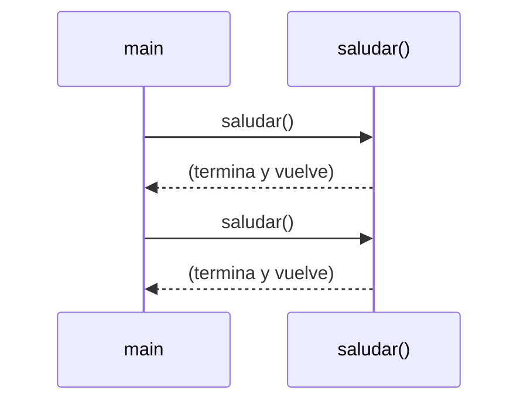
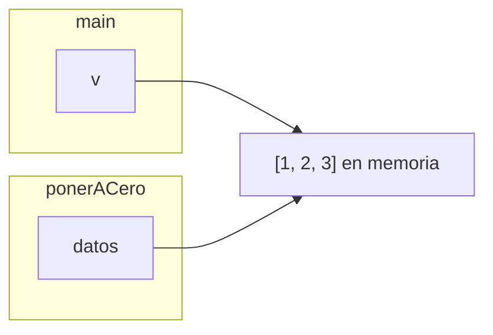

# Tema 10 · Métodos

[⬅️ Tema anterior](../09-strings/README.md) · [🏠 Índice](../../INDICE.md) · [Siguiente tema ➡️](../11-clases-y-objetos/README.md)

En los últimos ejercicios habrás notado que algunos trozos de código se repiten: mostrar un tablero, capitalizar un texto, pedir un número válido... Un **método** es un bloque de código con nombre que se escribe **una vez** y se usa **todas las veces que haga falta**. Es la herramienta que convierte un programa largo y difícil de leer en piezas pequeñas y claras.

## 🎯 Objetivos

- **Definir** y **llamar** métodos.
- Usar **parámetros** para darles datos y **`return`** para obtener resultados.
- Entender el **ámbito** de las variables.
- Saber qué significa que Java pase los argumentos **por valor** (y qué pasa con los arrays).
- **Sobrecargar** métodos.
- Documentar métodos con **Javadoc**.
- Escribir métodos **recursivos**.
- Dividir un programa en métodos bien diseñados.

## 📚 Contenido

1. [¿Por qué métodos?](#1-por-qué-métodos)
2. [Definir y llamar un método](#2-definir-y-llamar-un-método)
3. [Parámetros y argumentos](#3-parámetros-y-argumentos)
4. [Devolver un resultado: return](#4-devolver-un-resultado-return)
5. [Ámbito de las variables](#5-ámbito-de-las-variables)
6. [Paso por valor](#6-paso-por-valor)
7. [Sobrecarga](#7-sobrecarga)
8. [Documentar con Javadoc](#8-documentar-con-javadoc)
9. [Recursividad](#9-recursividad)
10. [Diseñar buenos métodos](#10-diseñar-buenos-métodos)
11. [Errores típicos](#11-errores-típicos)
12. [Resumen](#12-resumen)

---

## 1. ¿Por qué métodos?

Ya has usado muchos métodos sin escribirlos: `System.out.println(...)`, `Math.sqrt(...)`, `texto.toUpperCase()`, `Arrays.sort(...)`. Alguien los escribió una vez y todo el mundo los reutiliza. Ahora vas a crear los tuyos.

| Ventaja | Explicación |
|---|---|
| **No repetir código** | Si algo se hace en 5 sitios, se escribe en 1. Si hay que cambiarlo, se cambia en 1. |
| **Divide y vencerás** | Un problema grande se parte en tareas pequeñas, cada una en su método. |
| **Legibilidad** | `if (esPrimo(n))` se entiende sin leer cómo se calcula. |
| **Probar por partes** | Cada método se puede comprobar por separado. |

## 2. Definir y llamar un método

```java
public class Saludos {

    // DEFINICIÓN: fuera del main, pero dentro de la clase
    static void saludar() {
        System.out.println("¡Hola!");
        System.out.println("Bienvenido al programa");
    }

    public static void main(String[] args) {
        saludar();       // LLAMADA: se ejecuta el código del método
        saludar();       // Se puede llamar todas las veces que quieras
    }
}
```



Cuando el programa llega a una llamada, **salta** al método, ejecuta su código y **vuelve** justo después de la llamada.

### Partes de la cabecera

```java
static  double   calcularMedia   (int[] notas)
  │        │           │               │
  │        │           │               └─ Parámetros: los datos que recibe
  │        │           └─ Nombre: un verbo en camelCase
  │        └─ Tipo de retorno: qué devuelve (void si no devuelve nada)
  └─ static: de momento, siempre (permite llamarlo desde main sin crear objetos)
```

- **`static`** significa que el método pertenece a la clase y no a un objeto. Por ahora, todos nuestros métodos lo llevarán; entenderás el porqué en los temas 11 y 12.
- Los métodos se pueden escribir **antes o después** del `main`: el orden no importa.
- Un método **no puede** definirse dentro de otro método.

## 3. Parámetros y argumentos

Los **parámetros** son variables que el método recibe al ser llamado. Los valores concretos que se pasan en la llamada se llaman **argumentos**.

```java
static void saludar(String nombre, int veces) {   // Parámetros: nombre y veces
    for (int i = 0; i < veces; i++) {
        System.out.println("Hola, " + nombre);
    }
}

saludar("Ana", 2);          // Argumentos: "Ana" y 2
saludar("Luis", 1);
```

- Los argumentos se asignan a los parámetros **por orden**: el primero al primero, el segundo al segundo...
- El **número** y el **tipo** de los argumentos tienen que coincidir con los parámetros. `saludar(2, "Ana")` da error de compilación.
- Los argumentos pueden ser valores, variables o expresiones: `saludar(nombreUsuario, contador + 1)`.

## 4. Devolver un resultado: return

Un método puede **calcular un valor y devolverlo** a quien lo llamó. El tipo de retorno indica qué tipo de valor devuelve, y `return` lo entrega:

```java
static double areaCirculo(double radio) {
    double area = Math.PI * radio * radio;
    return area;                          // Entrega el valor y termina el método
}

double a = areaCirculo(3);                // El valor devuelto se guarda...
System.out.println(areaCirculo(1.5));     // ...o se usa directamente
double total = areaCirculo(1) + areaCirculo(2);
```

| Tipo de retorno | ¿Necesita `return valor`? | Cómo se usa |
|---|---|---|
| `void` | No (no devuelve nada) | `mostrarMenu();` como instrucción suelta |
| `int`, `double`, `boolean`, `String`, `int[]`... | **Sí**, en todos los caminos | `int x = calcular();` o dentro de una expresión |

Un método `boolean` es ideal para preguntas:

```java
static boolean esPar(int n) {
    return n % 2 == 0;           // Devuelve directamente el resultado de la comparación
}

if (esPar(numero)) { ... }       // Se lee casi como una frase
```

### Varios return

Un método puede tener varios `return` en distintas ramas de un `if`:

```java
static String calificar(double nota) {
    if (nota >= 9) {
        return "Sobresaliente";
    } else if (nota >= 5) {
        return "Aprobado";
    } else {
        return "Suspenso";
    }
}
```

Java exige que **todos** los caminos devuelvan algo. Si falta el `else`, da error: `missing return statement`.

> 📏 **Regla del repositorio:** igual que no usamos `break` para salir de un bucle, **tampoco usamos `return` dentro de un bucle** para salir de él antes de tiempo. Si hay que parar al encontrar algo, se usa una **bandera** en la condición del bucle y un único `return` después.

```java
// ✅ Así lo hacemos: el bucle termina por su condición
static boolean contiene(int[] datos, int buscado) {
    boolean encontrado = false;
    int i = 0;
    while (i < datos.length && !encontrado) {
        encontrado = datos[i] == buscado;
        i++;
    }
    return encontrado;
}
```

## 5. Ámbito de las variables

Cada método tiene sus **propias variables**. Las variables declaradas dentro de un método (incluidos los parámetros) son **locales**: solo existen mientras el método se ejecuta y no se ven desde fuera.

```java
static void metodoA() {
    int x = 10;          // x solo existe dentro de metodoA
}

static void metodoB() {
    // System.out.println(x);   // ❌ Error: cannot find symbol
    int x = 99;          // ✅ Es OTRA variable, aunque se llame igual
}
```

Por eso los métodos se comunican **solo** a través de los parámetros (datos de entrada) y del `return` (dato de salida). Eso los hace independientes y fáciles de entender.

## 6. Paso por valor

Cuando llamas a un método, Java **copia** el valor de cada argumento en el parámetro. Esto se llama **paso por valor**.

### Con tipos primitivos

El método trabaja con una **copia**: modificar el parámetro **no** cambia la variable original.

```java
static void duplicar(int n) {
    n = n * 2;                    // Cambia la COPIA
}

int numero = 5;
duplicar(numero);
System.out.println(numero);       // 5 (no ha cambiado)
```

Si quieres el resultado, **devuélvelo**: `static int duplicar(int n) { return n * 2; }` y `numero = duplicar(numero);`.

### Con arrays (y otros objetos)

Lo que se copia es la **referencia** (la dirección del array, tema 08). La copia apunta al **mismo array**, así que el método **sí puede modificar su contenido**:

```java
static void ponerACero(int[] datos) {
    for (int i = 0; i < datos.length; i++) {
        datos[i] = 0;             // Modifica el array ORIGINAL
    }
}

int[] v = {1, 2, 3};
ponerACero(v);
System.out.println(Arrays.toString(v));   // [0, 0, 0]
```



| Se pasa... | Se copia... | ¿El método puede cambiar el original? |
|---|---|---|
| `int`, `double`, `char`, `boolean`... | El valor | No |
| Un array | La referencia | Sí, su **contenido** |
| Un `String` | La referencia | No, porque los `String` son inmutables |

Esto es útil (un método puede ordenar o rellenar un array), pero también peligroso. Decide conscientemente: o el método **modifica** el array que recibe, o crea y **devuelve** uno nuevo, y déjalo claro en su nombre y su documentación.

## 7. Sobrecarga

Varios métodos pueden tener el **mismo nombre** si sus **parámetros son distintos** (en número o en tipo). Java elige cuál ejecutar según los argumentos de la llamada:

```java
static int sumar(int a, int b) {
    return a + b;
}

static int sumar(int a, int b, int c) {
    return a + b + c;
}

static double sumar(double a, double b) {
    return a + b;
}

sumar(2, 3);          // Llama a la primera  → 5
sumar(2, 3, 4);       // Llama a la segunda  → 9
sumar(2.5, 1.5);      // Llama a la tercera  → 4.0
```

Ya conoces métodos sobrecargados: `System.out.println` funciona con `int`, `double`, `String`, `char`... porque existen muchas versiones con el mismo nombre.

⚠️ Cambiar **solo el tipo de retorno** no es sobrecarga: `int calcular(int x)` y `double calcular(int x)` darían error.

## 8. Documentar con Javadoc

Un método bien documentado explica **qué hace**, **qué recibe** y **qué devuelve**, para que nadie tenga que leer su código para usarlo:

```java
/**
 * Calcula la media aritmética de un array de notas.
 *
 * @param notas las notas (no puede estar vacío)
 * @return la media de las notas
 */
static double calcularMedia(double[] notas) {
    ...
}
```

Los editores muestran esta documentación al pasar el ratón por encima de una llamada.

## 9. Recursividad

Un método **recursivo** es el que **se llama a sí mismo**. Sirve para problemas que se pueden expresar en función de una versión **más pequeña** del mismo problema.

El factorial es el ejemplo clásico: 5! = 5 × 4!, y 4! = 4 × 3!... hasta 1! = 1.

```java
static long factorial(int n) {
    if (n <= 1) {
        return 1;                      // CASO BASE: se resuelve sin recursividad
    } else {
        return n * factorial(n - 1);   // CASO RECURSIVO: se acerca al caso base
    }
}
```

Todo método recursivo necesita:

1. **Caso base:** una situación que se resuelve directamente y **detiene** la recursividad.
2. **Caso recursivo:** una llamada a sí mismo con un problema **más pequeño**, que se acerque al caso base.

### ¿Qué pasa por dentro?

Cada llamada espera a que termine la siguiente. Se forma una **pila de llamadas**:

```
factorial(4)
= 4 * factorial(3)
      = 3 * factorial(2)
            = 2 * factorial(1)
                  = 1               ← caso base
            = 2 * 1 = 2
      = 3 * 2 = 6
= 4 * 6 = 24
```

Si falta el caso base (o la llamada no se acerca a él), el método se llama infinitamente hasta que la pila se llena: **`StackOverflowError`**.

### ¿Recursividad o bucle?

Todo lo que se hace con recursividad se puede hacer con un bucle, y viceversa.

| | Recursividad | Bucle |
|---|---|---|
| Problemas que se dividen en subproblemas (árboles, laberintos, ordenaciones avanzadas) | Muy natural | Complicado |
| Repeticiones sencillas | Funciona, pero es más lenta y gasta más memoria | Más eficiente |

Para empezar, úsala en casos sencillos (factorial, potencias, cifras de un número) para entender la idea. La necesitarás en problemas más avanzados.

## 10. Diseñar buenos métodos

| Consejo | ❌ Mal | ✅ Bien |
|---|---|---|
| **Una sola tarea** | `leerCalcularYMostrar()` | `leerNotas()`, `calcularMedia()`, `mostrarInforme()` |
| **Nombre con verbo**, que diga qué hace | `datos()`, `m()` | `calcularMedia()`, `esPrimo()` |
| Los `boolean`, como **pregunta** | `primo(n)` | `esPrimo(n)`, `tieneMayuscula(t)` |
| **Devolver** mejor que **mostrar** | `void calcularMedia(...)` que hace `println` | `double calcularMedia(...)`: quien llama decide qué hacer con el resultado |
| **Pocos parámetros** (3 o 4 como mucho) | `crear(a, b, c, d, e, f, g)` | Agrupar datos (lo verás con objetos en el tema 11) |
| **Cortos** | 100 líneas | Si no cabe en la pantalla, probablemente se puede dividir |

Un buen `main` se lee casi como un índice del programa:

```java
public static void main(String[] args) {
    double[] notas = leerNotas(teclado);
    double media = calcularMedia(notas);
    mostrarInforme(notas, media);
}
```

## 11. Errores típicos

| Error | Ejemplo | Qué pasa |
|---|---|---|
| Falta `return` en algún camino | `if (x > 0) return 1;` sin `else` | `missing return statement` |
| Usar un método `void` como valor | `int x = mostrarMenu();` | Error de compilación: `incompatible types` |
| Ignorar el valor devuelto | `calcularMedia(notas);` | Se calcula y se pierde |
| Argumentos en otro orden o de otro tipo | `potencia(2.5, "3")` | Error de compilación |
| Esperar que cambie un primitivo | `duplicar(numero);` | `numero` sigue igual |
| Modificar un array sin querer | Ordenar el parámetro dentro de un método "de consulta" | Se altera el array original |
| Definir un método dentro de otro | Un método dentro del `main` | Error de compilación |
| Recursividad sin caso base | `f(n) { return f(n - 1); }` | `StackOverflowError` |
| Olvidar `static` | `void saludar()` llamado desde `main` | `non-static method cannot be referenced from a static context` |

## 12. Resumen

- Un **método** es un bloque con nombre que se define una vez y se llama las veces que haga falta.
- Recibe datos por sus **parámetros** y devuelve un resultado con **`return`** (o nada, si es `void`).
- Sus variables son **locales**: solo existen dentro del método.
- Java pasa los argumentos **por valor**: los primitivos no cambian fuera; los arrays sí pueden ver modificado su **contenido**.
- La **sobrecarga** permite varios métodos con el mismo nombre y distintos parámetros.
- Un método **recursivo** se llama a sí mismo y necesita un **caso base**.
- En este repositorio no usamos `return` para salir de un bucle: bandera y un `return` al final.

---

## 💻 Ejemplos de código

| Archivo | Qué muestra |
|---|---|
| [T10_01_DefinirYLlamar.java](ejemplos/T10_01_DefinirYLlamar.java) | Métodos `void`, flujo de las llamadas y parámetros |
| [T10_02_ReturnYAmbito.java](ejemplos/T10_02_ReturnYAmbito.java) | Devolver valores, métodos `boolean`, varios `return` y ámbito |
| [T10_03_PasoPorValor.java](ejemplos/T10_03_PasoPorValor.java) | Primitivos frente a arrays como parámetros |
| [T10_04_Sobrecarga.java](ejemplos/T10_04_Sobrecarga.java) | Varios métodos con el mismo nombre y Javadoc |
| [T10_05_Recursividad.java](ejemplos/T10_05_Recursividad.java) | Factorial, potencia, cifras, Fibonacci y la pila de llamadas |
| [T10_06_ProgramaConMetodos.java](ejemplos/T10_06_ProgramaConMetodos.java) | Un programa completo dividido en métodos |

## ✏️ Ejercicios

Practica lo aprendido en los [ejercicios del tema 10](../../ejercicios/10-metodos/README.md).

---

[⬅️ Tema anterior](../09-strings/README.md) · [🏠 Índice](../../INDICE.md) · [Siguiente tema ➡️](../11-clases-y-objetos/README.md)
