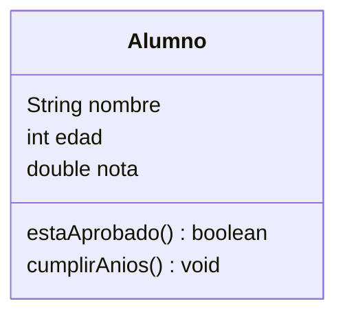
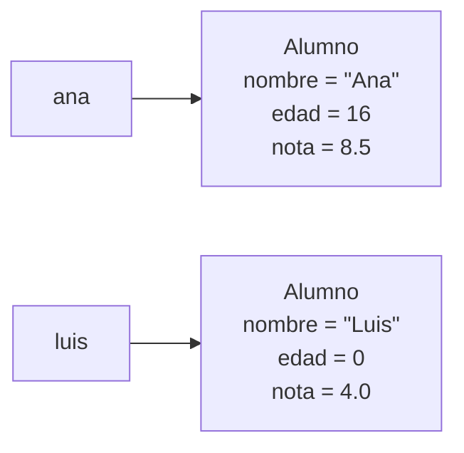

# Tema 11 · Clases y objetos

[⬅️ Tema anterior](../10-metodos/README.md) · [🏠 Índice](../../INDICE.md) · [Siguiente tema ➡️](../12-encapsulamiento/README.md)

Empieza la **Programación Orientada a Objetos** (POO), la forma de programar en la que está pensado Java. Hasta ahora, los datos de un alumno (nombre, notas, edad) vivían repartidos en variables o arrays paralelos. Con las **clases** puedes crear tus propios tipos de datos, que agrupan la **información** y el **comportamiento** de una cosa del mundo real en una sola pieza: el **objeto**.

## 🎯 Objetivos

- Entender qué es una **clase** y qué es un **objeto**.
- Definir clases con **atributos** y **métodos**.
- Crear objetos con **`new`** y usarlos con el operador punto.
- Escribir **constructores** y usar **`this`**.
- Entender la diferencia entre métodos **de instancia** y métodos **`static`**.
- Dar una representación de texto a un objeto con **`toString`**.
- Entender que las variables de objeto son **referencias**.
- Trabajar con **arrays de objetos**.

## 📚 Contenido

1. [El problema: datos sueltos](#1-el-problema-datos-sueltos)
2. [Clase y objeto](#2-clase-y-objeto)
3. [Definir una clase](#3-definir-una-clase)
4. [Crear y usar objetos](#4-crear-y-usar-objetos)
5. [Constructores](#5-constructores)
6. [La palabra this](#6-la-palabra-this)
7. [Métodos de instancia y métodos static](#7-métodos-de-instancia-y-métodos-static)
8. [El método toString](#8-el-método-tostring)
9. [Los objetos son referencias](#9-los-objetos-son-referencias)
10. [Arrays de objetos](#10-arrays-de-objetos)
11. [Las clases en este repositorio](#11-las-clases-en-este-repositorio)
12. [Errores típicos](#12-errores-típicos)
13. [Resumen](#13-resumen)

---

## 1. El problema: datos sueltos

En el tema 08 guardabas los datos de varios alumnos en **arrays paralelos**:

```java
String[] nombres = {"Ana", "Luis", "Marta"};
int[] edades = {15, 16, 15};
double[] notas = {8.5, 6.0, 9.2};
```

Funciona, pero tiene problemas: si ordenas `notas`, tienes que acordarte de mover también `nombres` y `edades`; si añades un dato nuevo (el correo), aparece otro array; y nada impide mezclar los datos de un alumno con los de otro.

Lo natural sería tener **un único "alumno"** que contenga su nombre, su edad y su nota, y que sepa hacer cosas como "decir si ha aprobado". Eso es un **objeto**.

## 2. Clase y objeto

| Concepto | Qué es | Analogía |
|---|---|---|
| **Clase** | El **molde** o plano: describe qué datos y qué comportamiento tendrán | El plano de una casa / el molde de galletas |
| **Objeto** (o **instancia**) | Una cosa **concreta** creada a partir de la clase, con sus propios valores | Cada casa construida / cada galleta |

De una misma clase `Alumno` se pueden crear tantos objetos como quieras: Ana, Luis, Marta... Todos tienen nombre, edad y nota, pero **cada uno con sus propios valores**.

Una clase tiene dos tipos de miembros:

| Miembro | Qué representa | Ejemplo en `Alumno` |
|---|---|---|
| **Atributos** (campos) | Lo que el objeto **es** o **tiene**: sus datos | `nombre`, `edad`, `nota` |
| **Métodos** | Lo que el objeto **sabe hacer** | `estaAprobado()`, `cumplirAnios()` |

Se suele dibujar con un **diagrama de clases**:



## 3. Definir una clase

```java
class Alumno {

    // ATRIBUTOS: los datos de cada alumno
    String nombre;
    int edad;
    double nota;

    // MÉTODOS: lo que sabe hacer un alumno (sin static)
    boolean estaAprobado() {
        return nota >= 5;          // Usa el atributo de ESTE alumno
    }

    void cumplirAnios() {
        edad++;
    }
}
```

- El nombre de una clase va en **PascalCase** y en singular: `Alumno`, `CuentaBancaria`.
- Los atributos se declaran dentro de la clase, **fuera** de los métodos.
- Los métodos de un objeto **no** llevan `static`. Pueden usar directamente los atributos: `nota` es la nota **del alumno sobre el que se llama** el método.
- A diferencia de las variables locales, los atributos **tienen valor por defecto** (los mismos que en los arrays: `0`, `0.0`, `false`, `null`).

## 4. Crear y usar objetos

Un objeto se crea con **`new`**. Después, se accede a sus atributos y métodos con un **punto**:

```java
Alumno ana = new Alumno();      // Crea un objeto Alumno nuevo
ana.nombre = "Ana";             // Da valor a sus atributos
ana.edad = 15;
ana.nota = 8.5;

Alumno luis = new Alumno();     // Otro objeto, independiente del primero
luis.nombre = "Luis";
luis.nota = 4.0;

System.out.println(ana.estaAprobado());    // true
System.out.println(luis.estaAprobado());   // false
ana.cumplirAnios();                        // Solo cambia la edad de Ana
```



Fíjate en `luis.edad`: no le dimos valor, así que vale `0` (el valor por defecto). Para evitar objetos "a medio hacer" existen los constructores.

## 5. Constructores

Un **constructor** es un método especial que se ejecuta **al crear** el objeto con `new`. Sirve para darle sus valores iniciales.

```java
class Alumno {
    String nombre;
    int edad;
    double nota;

    // Constructor: mismo nombre que la clase y SIN tipo de retorno (ni siquiera void)
    Alumno(String nombre, int edad, double nota) {
        this.nombre = nombre;
        this.edad = edad;
        this.nota = nota;
    }
}

Alumno ana = new Alumno("Ana", 15, 8.5);   // Creado y listo en una línea
```

| Regla | Detalle |
|---|---|
| Nombre | Igual que la clase |
| Tipo de retorno | Ninguno (si pones `void`, deja de ser un constructor) |
| ¿Cuándo se ejecuta? | Al hacer `new` |
| Si no escribes ninguno | Java crea uno **por defecto**, sin parámetros, que no hace nada |
| Si escribes alguno | El constructor por defecto **desaparece**: `new Alumno()` dará error si no lo defines tú |

### Varios constructores (sobrecarga)

Como los métodos del tema 10, los constructores se pueden **sobrecargar**. Con **`this(...)`** un constructor puede llamar a otro, para no repetir código:

```java
Alumno(String nombre, int edad, double nota) {
    this.nombre = nombre;
    this.edad = edad;
    this.nota = nota;
}

Alumno(String nombre, int edad) {
    this(nombre, edad, 0.0);      // Llama al constructor completo con nota 0
}
```

`this(...)` tiene que ser la **primera instrucción** del constructor.

## 6. La palabra this

`this` significa **"este objeto"**: el objeto sobre el que se está ejecutando el método o el constructor.

Su uso más habitual es distinguir un **atributo** de un **parámetro** que se llama igual:

```java
Alumno(String nombre, int edad, double nota) {
    this.nombre = nombre;    // this.nombre = el ATRIBUTO   |   nombre = el PARÁMETRO
}
```

Sin `this`, `nombre = nombre;` asignaría el parámetro a sí mismo y el atributo se quedaría en `null`. Es un error muy frecuente.

También se usa para pasar el propio objeto a otro método (`otro.compararCon(this)`) y, como has visto, para llamar a otro constructor (`this(...)`).

## 7. Métodos de instancia y métodos static

Ahora ya puedes entender el `static` que llevas usando desde el tema 02:

| | Método **de instancia** (sin `static`) | Método **`static`** |
|---|---|---|
| Pertenece a... | **Cada objeto** | La **clase** |
| Se llama con... | Un objeto: `ana.estaAprobado()` | La clase: `Math.sqrt(9)` |
| ¿Puede usar los atributos del objeto? | Sí | No (no hay ningún objeto) |
| Ejemplos | `texto.toUpperCase()`, `lista.add(x)` | `Math.max(a, b)`, `Integer.parseInt(t)`, `main` |

El `main` es `static` porque la JVM lo llama **sin crear ningún objeto**. Por eso, en los temas anteriores, los métodos que llamábamos desde el `main` también tenían que ser `static`. Lo verás con más detalle en el [tema 12](../12-encapsulamiento/README.md).

## 8. El método toString

Si muestras un objeto con `println`, verás algo como `Alumno@1b6d3586` (el nombre de la clase y un código interno). Para que muestre algo útil, se escribe un método **`toString`** que devuelva un texto:

```java
@Override
public String toString() {
    return nombre + " (" + edad + " años) - nota: " + nota;
}

System.out.println(ana);            // Ana (15 años) - nota: 8.5
String texto = "Alumno: " + ana;    // También al concatenar
```

- Java llama a `toString()` **automáticamente** cuando un objeto se usa como texto (`println`, `+` con un `String`...).
- Tiene que escribirse exactamente así: `public String toString()`.
- `@Override` indica que estás **redefiniendo** un método que ya existe en todas las clases. Lo entenderás en el [tema 13](../13-herencia-y-polimorfismo/README.md); de momento, ponlo siempre.

## 9. Los objetos son referencias

Igual que los arrays (tema 08), una variable de tipo objeto **no contiene el objeto**: contiene una **referencia** a él.

```java
Alumno a = new Alumno("Ana", 15, 8.5);
Alumno b = a;           // ⚠️ No copia el alumno: las dos variables apuntan al MISMO objeto
b.nota = 10;
System.out.println(a.nota);   // 10
```

Consecuencias:

- **`==`** compara si dos variables apuntan al **mismo objeto**, no si tienen los mismos datos. Para comparar contenidos se escribe un método `equals` (tema 13).
- Un método que recibe un objeto **puede modificarlo** (como pasaba con los arrays en el tema 10).
- Una variable de objeto puede valer **`null`**: no apunta a ningún objeto. Usar un método o atributo sobre `null` provoca **`NullPointerException`**.

```java
Alumno nadie = null;
// nadie.estaAprobado();   // ❌ NullPointerException
if (nadie != null) {       // ✅ Comprobar antes de usar
    ...
}
```

## 10. Arrays de objetos

Un array puede guardar objetos. Cada posición contiene una **referencia** (al principio, `null`):

```java
Alumno[] clase = new Alumno[3];               // 3 huecos vacíos (null)
clase[0] = new Alumno("Ana", 15, 8.5);
clase[1] = new Alumno("Luis", 16, 4.0);
clase[2] = new Alumno("Marta", 15, 9.2);

// O directamente:
Alumno[] otraClase = {
    new Alumno("Ana", 15, 8.5),
    new Alumno("Luis", 16, 4.0)
};

for (Alumno alumno : clase) {
    if (alumno.estaAprobado()) {
        System.out.println(alumno.nombre);
    }
}
```

Ahora los datos de cada alumno **viajan juntos**: si ordenas el array, cada alumno se mueve con todos sus datos. Se acabaron los arrays paralelos.

## 11. Las clases en este repositorio

En un proyecto real, **cada clase va en su propio archivo** (`Alumno.java`, `Biblioteca.java`...). En este repositorio queremos que cada ejemplo y cada ejercicio siga siendo **un solo archivo** que se ejecute con `java Archivo.java`, así que las clases auxiliares se escriben **dentro** de la clase principal, con `static class`:

```java
public class T11_01_PrimeraClase {

    static class Alumno {          // Clase anidada: vive dentro de la principal
        String nombre;
        ...
    }

    public static void main(String[] args) {
        Alumno ana = new Alumno(); // Se usa exactamente igual
    }
}
```

Aquí `static` solo significa que la clase `Alumno` se puede usar sin crear antes un objeto de la clase principal. Todo lo demás (atributos, métodos, constructores, `this`...) funciona **igual** que en una clase en su propio archivo. Además, así no hay conflictos entre clases con el mismo nombre en distintos ejercicios.

## 12. Errores típicos

| Error | Ejemplo | Qué pasa |
|---|---|---|
| Usar un objeto sin crearlo | `Alumno a; a.nombre = "Ana";` | Error de compilación: `might not have been initialized` |
| Usar una referencia `null` | `Alumno a = null; a.estaAprobado();` | `NullPointerException` |
| Olvidar `this` en el constructor | `nombre = nombre;` | El atributo se queda en `null` / 0 |
| Poner `void` al constructor | `void Alumno(...) { ... }` | Deja de ser constructor: `new Alumno(...)` da error |
| Usar el constructor por defecto tras escribir otro | `new Alumno()` | `constructor Alumno in class Alumno cannot be applied` |
| Llamar a un método de instancia como `static` | `Alumno.estaAprobado()` | `non-static method cannot be referenced from a static context` |
| Mostrar el objeto sin `toString` | `println(ana)` | `Alumno@1b6d3586` |
| "Copiar" con `=` | `Alumno b = a;` | Las dos variables comparten el objeto |
| Recorrer un array de objetos con huecos `null` | `clase[2].nombre` sin haberlo creado | `NullPointerException` |

## 13. Resumen

- Una **clase** es un molde; un **objeto** es una instancia concreta creada con **`new`**.
- Los **atributos** guardan el estado de cada objeto; los **métodos** (sin `static`) definen su comportamiento.
- El **constructor** inicializa el objeto: mismo nombre que la clase, sin tipo de retorno. Se puede sobrecargar y encadenar con `this(...)`.
- **`this`** es el objeto actual; distingue atributos de parámetros con el mismo nombre.
- **`toString`** define cómo se muestra el objeto como texto.
- Las variables de objeto son **referencias**: `=` comparte el objeto, `==` compara referencias y `null` significa "ningún objeto".
- Los **arrays de objetos** sustituyen a los arrays paralelos.

---

## 💻 Ejemplos de código

| Archivo | Qué muestra |
|---|---|
| [T11_01_PrimeraClase.java](ejemplos/T11_01_PrimeraClase.java) | Definir una clase, crear objetos y usar sus atributos y métodos |
| [T11_02_Constructores.java](ejemplos/T11_02_Constructores.java) | Constructores, sobrecarga, `this` y `this(...)` |
| [T11_03_ToStringYReferencias.java](ejemplos/T11_03_ToStringYReferencias.java) | `toString`, referencias compartidas, `==` y `null` |
| [T11_04_ObjetosYMetodos.java](ejemplos/T11_04_ObjetosYMetodos.java) | Objetos como parámetros y como resultado; objetos que contienen otros objetos |
| [T11_05_ArraysDeObjetos.java](ejemplos/T11_05_ArraysDeObjetos.java) | Recorrer, buscar y ordenar un array de objetos |

## ✏️ Ejercicios

Practica lo aprendido en los [ejercicios del tema 11](../../ejercicios/11-clases-y-objetos/README.md).

---

[⬅️ Tema anterior](../10-metodos/README.md) · [🏠 Índice](../../INDICE.md) · [Siguiente tema ➡️](../12-encapsulamiento/README.md)
