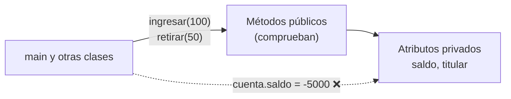
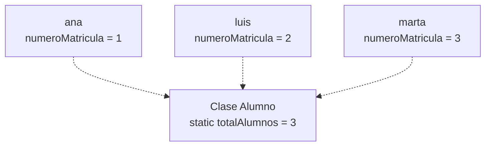

# Tema 12 · Encapsulamiento

[⬅️ Tema anterior](../11-clases-y-objetos/README.md) · [🏠 Índice](../../INDICE.md) · [Siguiente tema ➡️](../13-herencia-y-polimorfismo/README.md)

En el tema 11, cualquiera podía escribir `cuenta.saldo = -5000;` o `alumno.nota = 47;`. Nada impedía dejar un objeto en un estado absurdo. El **encapsulamiento** consiste en **proteger** los datos de un objeto y permitir cambiarlos solo a través de métodos que **comprueban** que el cambio tiene sentido. Además, en este tema entenderás del todo qué significan `static` y `final`.

## 🎯 Objetivos

- Conocer los **modificadores de acceso**: `private`, `public` y el acceso por defecto.
- Ocultar los atributos y exponer **getters** y **setters**.
- **Validar** los datos en constructores y setters para que el objeto esté siempre en un estado correcto.
- Usar **métodos privados** de ayuda.
- Entender los miembros **`static`**: atributos y métodos de clase.
- Usar **`final`** en atributos y crear objetos **inmutables**.
- Evitar "fugas" de datos internos con **copias defensivas**.

## 📚 Contenido

1. [El problema: atributos sin protección](#1-el-problema-atributos-sin-protección)
2. [Modificadores de acceso](#2-modificadores-de-acceso)
3. [Encapsular: atributos privados](#3-encapsular-atributos-privados)
4. [Getters y setters](#4-getters-y-setters)
5. [Validar los datos](#5-validar-los-datos)
6. [Métodos privados](#6-métodos-privados)
7. [Miembros static](#7-miembros-static)
8. [final y objetos inmutables](#8-final-y-objetos-inmutables)
9. [Copias defensivas](#9-copias-defensivas)
10. [Encapsulamiento y clases anidadas en este repositorio](#10-encapsulamiento-y-clases-anidadas-en-este-repositorio)
11. [Errores típicos](#11-errores-típicos)
12. [Resumen](#12-resumen)

---

## 1. El problema: atributos sin protección

```java
class CuentaBancaria {
    String titular;
    double saldo;
}

CuentaBancaria cuenta = new CuentaBancaria();
cuenta.saldo = -5000;        // 😱 Nada lo impide
cuenta.titular = "";         // 😱 Una cuenta sin titular
```

Cualquier parte del programa puede modificar los atributos directamente y sin control. Si el programa es grande, encontrar **quién** dejó el saldo en negativo es una pesadilla.

La solución: que **solo la propia clase** pueda tocar sus datos, y que el resto del programa tenga que **pedírselo** a través de métodos que validan.



## 2. Modificadores de acceso

Un **modificador de acceso** indica **desde dónde** se puede usar un atributo, un método o una clase.

| Modificador | ¿Desde dónde se puede usar? | Uso típico |
|---|---|---|
| `private` | Solo desde **dentro de la misma clase** | Atributos y métodos de ayuda |
| *(ninguno)* | Desde las clases del mismo **paquete** | Poco habitual a propósito |
| `protected` | Mismo paquete y **subclases** | Herencia ([tema 13](../13-herencia-y-polimorfismo/README.md)) |
| `public` | Desde **cualquier sitio** | Métodos que forman la "interfaz" de la clase |

Un **paquete** es una carpeta que agrupa clases relacionadas (como `java.util`). En este repositorio no usamos paquetes, así que, en la práctica, distinguiremos entre `private` y `public`.

La regla general:

> **Atributos `private`, métodos `public`** (salvo los de ayuda, que también son `private`).

## 3. Encapsular: atributos privados

```java
class CuentaBancaria {
    private String titular;
    private double saldo;

    public CuentaBancaria(String titular) {
        this.titular = titular;
        this.saldo = 0;
    }

    public void ingresar(double cantidad) {
        if (cantidad > 0) {
            saldo += cantidad;
        }
    }

    public double getSaldo() {
        return saldo;
    }
}

CuentaBancaria cuenta = new CuentaBancaria("Ana");
cuenta.ingresar(100);
System.out.println(cuenta.getSaldo());   // 100.0
// cuenta.saldo = -5000;                 // ❌ Error: saldo has private access in CuentaBancaria
```

Ahora la **única** forma de cambiar el saldo es `ingresar` (y, más adelante, `retirar`), y los dos comprueban que la operación es válida. El objeto **se protege a sí mismo**.

Ventajas del encapsulamiento:

| Ventaja | Explicación |
|---|---|
| **Integridad** | El objeto nunca queda en un estado inválido |
| **Control** | Se puede registrar, validar o calcular algo en cada cambio |
| **Libertad para cambiar** | Puedes cambiar cómo se guardan los datos por dentro sin romper el código que usa la clase |
| **Facilidad de uso** | Quien usa la clase solo ve unos pocos métodos con nombres claros |

## 4. Getters y setters

Son los métodos públicos más habituales para leer y modificar un atributo privado:

```java
private String nombre;
private int edad;
private boolean activo;

public String getNombre() {              // GETTER: get + Atributo
    return nombre;
}

public void setNombre(String nombre) {   // SETTER: set + Atributo
    this.nombre = nombre;
}

public boolean isActivo() {              // Para boolean, el getter se llama is...
    return activo;
}
```

**No todos los atributos necesitan getter y setter.** Piensa en cada uno:

| Atributo | ¿Getter? | ¿Setter? | Motivo |
|---|---|---|---|
| `saldo` | Sí | **No** | Solo cambia con `ingresar` y `retirar` |
| `numeroCuenta` | Sí | **No** | No debe cambiar nunca |
| `titular` | Sí | Quizá | Depende de las reglas del banco |
| `pin` | **No** | Con validación | No se debe poder consultar |

Generar getters y setters para todo, de forma automática, anula gran parte de la protección. El objetivo no es "esconder por esconder", sino **controlar** cómo se usa el objeto.

> Los editores pueden generar getters y setters automáticamente (en VS Code: clic derecho → *Source Action*; en IntelliJ: `Alt + Insert`).

## 5. Validar los datos

La gran ventaja de un setter (o de cualquier método que cambie el estado) es que puede **comprobar** el dato antes de aceptarlo:

```java
public void setEdad(int edad) {
    if (edad >= 0 && edad <= 150) {
        this.edad = edad;
    } else {
        System.out.println("Edad no válida: " + edad);   // El valor anterior se conserva
    }
}
```

Los **constructores** también deben validar, porque son la puerta de entrada de los datos iniciales. Una buena técnica es que el constructor **use los setters**, para no repetir las validaciones:

```java
public Persona(String nombre, int edad) {
    setNombre(nombre);
    setEdad(edad);
}
```

Otra opción es que los métodos que pueden fallar **devuelvan un `boolean`** para que quien los llama sepa si se ha hecho:

```java
public boolean retirar(double cantidad) {
    boolean posible = cantidad > 0 && cantidad <= saldo;
    if (posible) {
        saldo -= cantidad;
    }
    return posible;
}
```

> Mostrar mensajes desde una clase o devolver `false` funciona, pero tiene límites. La forma profesional de avisar de un error en Java son las **excepciones**, que verás en el [tema 15](../15-excepciones/README.md).

## 6. Métodos privados

Un método `private` solo se puede llamar desde dentro de la clase. Sirve para dividir el trabajo interno en piezas sin "ensuciar" lo que ve el resto del programa:

```java
public boolean cambiarPin(String pinActual, String pinNuevo) {
    boolean cambiado = pinActual.equals(pin) && esPinValido(pinNuevo);
    if (cambiado) {
        pin = pinNuevo;
    }
    return cambiado;
}

private boolean esPinValido(String p) {     // Detalle interno: no forma parte de la "interfaz"
    return p.length() == 4 && p.chars().allMatch(Character::isDigit);
}
```

(La expresión `p.chars().allMatch(...)` comprueba que todos los caracteres sean dígitos; la entenderás en el tema 19. Se puede hacer igual con un bucle.)

## 7. Miembros static

Un miembro `static` pertenece a la **clase**, no a cada objeto. Hay **una sola copia** compartida por todos los objetos.

### Atributos static

```java
class Alumno {
    private static int totalAlumnos = 0;     // Uno para TODA la clase
    private final int numeroMatricula;      // Uno por CADA objeto
    private String nombre;

    public Alumno(String nombre) {
        this.nombre = nombre;
        totalAlumnos++;                      // Cada alumno nuevo incrementa el contador común
        this.numeroMatricula = totalAlumnos; // Número único y automático
    }

    public static int getTotalAlumnos() {
        return totalAlumnos;
    }
}
```



Usos típicos: **contadores** de objetos creados, **identificadores** automáticos y **constantes** compartidas.

### Constantes: static final

```java
public static final double IVA = 0.21;
public static final int MAX_ALUMNOS_POR_CLASE = 30;
```

Una constante que no depende de ningún objeto concreto se declara `static final`, en `MAYUSCULAS`. Se usa con el nombre de la clase: `Factura.IVA`, `Math.PI`, `Integer.MAX_VALUE`.

### Métodos static

Un método `static` no tiene objeto, así que **no puede usar los atributos de instancia ni `this`**. Se usa para operaciones que no dependen de un objeto concreto: `Math.sqrt`, `Integer.parseInt`, `Arrays.sort` o métodos de utilidad como `esHoraValida` del ejercicio del parking.

| | De instancia | `static` |
|---|---|---|
| ¿Cuántas copias? | Una por objeto | Una para toda la clase |
| ¿Cómo se usa? | `objeto.metodo()` | `Clase.metodo()` |
| ¿Puede usar `this` y atributos de instancia? | Sí | No |
| ¿Puede usar miembros `static`? | Sí | Sí |

Por esto el `main` (que es `static`) no podía llamar a métodos sin `static` en el tema 10: no había ningún objeto sobre el que llamarlos.

## 8. final y objetos inmutables

### Atributos final

Un atributo `final` recibe valor **una sola vez** (en su declaración o en el constructor) y ya no puede cambiar:

```java
class Cuenta {
    private final String numeroCuenta;   // Se fija al crear la cuenta

    public Cuenta(String numero) {
        this.numeroCuenta = numero;      // ✅ Primera y única asignación
    }

    public void cambiar() {
        // numeroCuenta = "otro";        // ❌ Error: cannot assign a value to final variable
    }
}
```

Java obliga a que **todo** constructor dé valor a los atributos `final`.

### Objetos inmutables

Un objeto es **inmutable** si, una vez creado, su estado no puede cambiar. `String` es el ejemplo más conocido (tema 09). Para crear una clase inmutable:

1. Todos los atributos `private final`.
2. Sin setters.
3. Los métodos que "modifican" devuelven un **objeto nuevo**.

```java
class Punto {
    private final int x;
    private final int y;

    public Punto(int x, int y) {
        this.x = x;
        this.y = y;
    }

    public Punto mover(int dx, int dy) {
        return new Punto(x + dx, y + dy);   // El original no cambia
    }
}
```

Los objetos inmutables son más fáciles de entender y se pueden compartir sin miedo: nadie los puede alterar. En el [tema 18](../18-enums-y-records/README.md) verás los `record`, que crean clases inmutables con muy poco código.

### final en clases y métodos

- Una **clase** `final` no se puede heredar (`String` es `final`).
- Un **método** `final` no se puede redefinir en una subclase.

Lo entenderás en el [tema 13](../13-herencia-y-polimorfismo/README.md).

## 9. Copias defensivas

Cuidado con los atributos que son **referencias** (arrays u objetos modificables). Si un getter devuelve directamente el array interno, quien lo recibe puede modificarlo **saltándose** todas las validaciones:

```java
class Clase {
    private double[] notas = {7, 8, 9};

    public double[] getNotas() {
        return notas;                    // ⚠️ Entrega la referencia al array interno
    }
}

clase.getNotas()[0] = -100;             // 😱 Se modifica el array privado desde fuera
```

La solución es devolver una **copia** (tema 08):

```java
public double[] getNotas() {
    return Arrays.copyOf(notas, notas.length);   // ✅ Quien la modifique, modifica su copia
}
```

Lo mismo al **recibir** un array en el constructor: si se guarda tal cual, quien lo pasó puede seguir modificándolo desde fuera. Se guarda una copia.

## 10. Encapsulamiento y clases anidadas en este repositorio

Como viste en el tema 11, en este repositorio las clases auxiliares van **dentro** de la clase principal (`static class`). Java tiene una regla especial: **la clase que contiene a otra puede acceder a sus miembros `private`**. Es decir, desde el `main` de nuestros ejercicios el compilador **no te impedirá** escribir `cuenta.saldo = -5000;`.

Por eso:

- En el ejemplo [T12_01](ejemplos/T12_01_ProblemaYPrivate.java), la clase auxiliar está **fuera** de la clase principal, para que veas el error de compilación real.
- En el resto de ejemplos y ejercicios, **respeta el encapsulamiento tú**: desde el `main` usa solo los métodos públicos, como harías si cada clase estuviera en su propio archivo. Las soluciones lo hacen siempre así.

## 11. Errores típicos

| Error | Ejemplo | Qué pasa |
|---|---|---|
| Acceder a un atributo `private` desde otra clase | `cuenta.saldo = 0;` | `saldo has private access` |
| Setter sin `this` | `saldo = saldo;` | El atributo no cambia |
| Setter que no valida | `setEdad(-3)` acepta el valor | Objeto en estado inválido |
| Constructor que no valida | `new Persona("", -5)` | Igual que el anterior |
| Getter de un `boolean` llamado `getActivo` | | Funciona, pero la convención es `isActivo` |
| Usar un atributo de instancia en un método `static` | `static void f() { saldo++; }` | `non-static variable cannot be referenced from a static context` |
| Contador de objetos sin `static` | `private int total;` | Cada objeto tiene su propio contador, siempre a 1 |
| No dar valor a un atributo `final` | | `variable might not have been initialized` |
| Devolver el array interno en un getter | `return notas;` | Se puede modificar desde fuera |

## 12. Resumen

- **Encapsular** es ocultar los datos (`private`) y ofrecer métodos (`public`) que controlan cómo se leen y modifican.
- **Getters** (`getX`, `isX`) y **setters** (`setX`) solo cuando tienen sentido; los setters y constructores **validan**.
- Los métodos de ayuda internos son **`private`**.
- **`static`**: una sola copia para toda la clase (contadores, identificadores, constantes, utilidades). Un método `static` no tiene `this`.
- **`final`**: el valor no cambia tras asignarse. Atributos `private final` + sin setters = objeto **inmutable**.
- Cuidado con devolver referencias internas: usa **copias defensivas**.

---

## 💻 Ejemplos de código

| Archivo | Qué muestra |
|---|---|
| [T12_01_ProblemaYPrivate.java](ejemplos/T12_01_ProblemaYPrivate.java) | El problema de los atributos públicos y el error de `private` |
| [T12_02_GettersYSetters.java](ejemplos/T12_02_GettersYSetters.java) | Una cuenta bancaria encapsulada con validaciones |
| [T12_03_Static.java](ejemplos/T12_03_Static.java) | Atributos y métodos `static`: contadores, identificadores y constantes |
| [T12_04_FinalEInmutables.java](ejemplos/T12_04_FinalEInmutables.java) | Atributos `final` y una clase inmutable |
| [T12_05_CopiasDefensivas.java](ejemplos/T12_05_CopiasDefensivas.java) | Métodos privados y copias defensivas de arrays |

## ✏️ Ejercicios

Practica lo aprendido en los [ejercicios del tema 12](../../ejercicios/12-encapsulamiento/README.md).

---

[⬅️ Tema anterior](../11-clases-y-objetos/README.md) · [🏠 Índice](../../INDICE.md) · [Siguiente tema ➡️](../13-herencia-y-polimorfismo/README.md)
