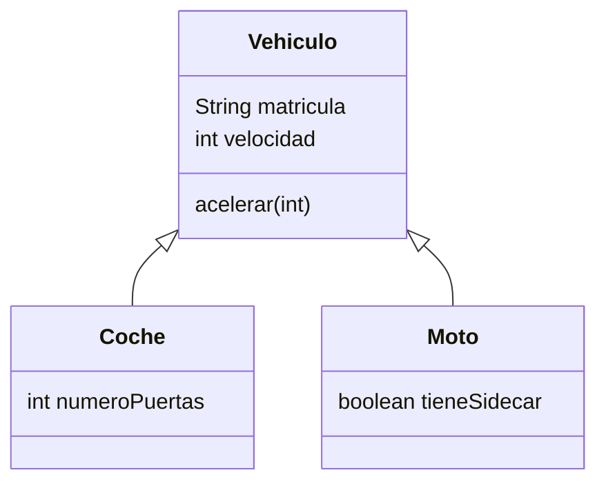
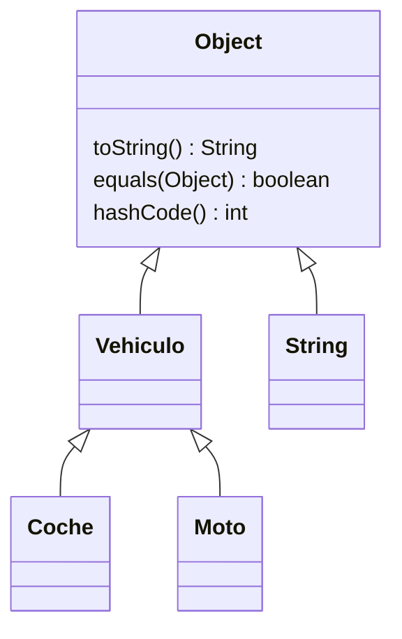

# Tema 13 · Herencia y polimorfismo

[⬅️ Tema anterior](../12-encapsulamiento/README.md) · [🏠 Índice](../../INDICE.md) · [Siguiente tema ➡️](../14-abstraccion-e-interfaces/README.md)

Un coche, una moto y un camión son distintos, pero los tres son **vehículos**: tienen matrícula, se pueden arrancar y llevan un conductor. La **herencia** permite escribir lo común una sola vez (en `Vehiculo`) y que cada tipo concreto **añada** o **cambie** solo lo suyo. El **polimorfismo** permite tratar a todos por igual ("arranca todos los vehículos") y que cada uno responda **a su manera**.

## 🎯 Objetivos

- Crear subclases con **`extends`** y entender qué se hereda.
- Encadenar constructores con **`super(...)`** y usar **`protected`**.
- **Sobrescribir** métodos con `@Override` y reutilizar la versión de la superclase con `super.metodo()`.
- Entender el **polimorfismo**: una variable de un tipo general que guarda objetos de tipos concretos.
- Usar **`instanceof`** (con patrones) y el **casting** entre clases.
- Conocer la clase **`Object`** y escribir `equals`, `hashCode` y `toString`.
- Saber cuándo usar **herencia** y cuándo **composición**.

## 📚 Contenido

1. [¿Por qué herencia?](#1-por-qué-herencia)
2. [extends: crear una subclase](#2-extends-crear-una-subclase)
3. [Constructores y super](#3-constructores-y-super)
4. [protected](#4-protected)
5. [Sobrescritura de métodos](#5-sobrescritura-de-métodos)
6. [Polimorfismo](#6-polimorfismo)
7. [instanceof y casting](#7-instanceof-y-casting)
8. [La clase Object](#8-la-clase-object)
9. [equals y hashCode](#9-equals-y-hashcode)
10. [final y herencia simple](#10-final-y-herencia-simple)
11. [Herencia frente a composición](#11-herencia-frente-a-composición)
12. [Errores típicos](#12-errores-típicos)
13. [Resumen](#13-resumen)

---

## 1. ¿Por qué herencia?

Sin herencia, dos clases parecidas repiten código:

```java
class Coche {                       class Moto {
    String matricula;                   String matricula;
    int velocidad;                      int velocidad;
    void acelerar(int v) { ... }        void acelerar(int v) { ... }
    int numeroPuertas;                  boolean tieneSidecar;
}                                   }
```

Si mañana cambia cómo se acelera, hay que cambiarlo en las dos. Con herencia, lo común va en una **superclase** y cada **subclase** solo añade lo propio:



La herencia expresa una relación **"es un"**: un coche **es un** vehículo, una moto **es un** vehículo. Si la frase no tiene sentido ("un motor es un coche"), la herencia no es la herramienta adecuada.

| Término | Significado |
|---|---|
| **Superclase** (clase padre, clase base) | La clase general: `Vehiculo` |
| **Subclase** (clase hija, clase derivada) | La clase concreta que hereda: `Coche` |

## 2. extends: crear una subclase

```java
class Vehiculo {
    protected String matricula;
    protected int velocidad;

    public void acelerar(int incremento) {
        velocidad += incremento;
    }
}

class Coche extends Vehiculo {        // Coche hereda de Vehiculo
    private int numeroPuertas;

    public void abrirMaletero() {
        System.out.println("Maletero abierto");
    }
}

Coche c = new Coche();
c.acelerar(50);          // Heredado de Vehiculo
c.abrirMaletero();       // Propio de Coche
```

Una subclase **hereda** todos los atributos y métodos de su superclase y puede **añadir** los suyos.

| Miembro de la superclase | ¿Lo tiene la subclase? | ¿Puede usarlo directamente? |
|---|---|---|
| `public` | Sí | Sí |
| `protected` | Sí | Sí |
| `private` | Sí (existe dentro del objeto) | **No**: tiene que usar los métodos públicos o protegidos |
| Constructores | **No se heredan** | Se llaman con `super(...)` |

## 3. Constructores y super

Los constructores **no se heredan**: cada clase tiene los suyos. Pero al crear un `Coche`, también hay que inicializar la parte de `Vehiculo`. Para eso, el constructor de la subclase llama al de la superclase con **`super(...)`**:

```java
class Vehiculo {
    protected String matricula;

    public Vehiculo(String matricula) {
        this.matricula = matricula;
    }
}

class Coche extends Vehiculo {
    private int numeroPuertas;

    public Coche(String matricula, int numeroPuertas) {
        super(matricula);                  // 1º: inicializa la parte de Vehiculo
        this.numeroPuertas = numeroPuertas; // 2º: inicializa lo propio
    }
}
```

- `super(...)` tiene que ser la **primera instrucción** del constructor.
- Si no lo escribes, Java pone `super()` (sin parámetros) automáticamente. Si la superclase **no tiene** constructor sin parámetros, da error de compilación.
- Al crear un objeto, los constructores se ejecutan **de arriba abajo**: primero el de la superclase y después el de la subclase.

| Palabra | Se refiere a... | Usos |
|---|---|---|
| `this` | Este objeto | `this.atributo`, `this(...)` (otro constructor de la misma clase) |
| `super` | La parte de la superclase de este objeto | `super(...)` (constructor de la superclase), `super.metodo()` |

## 4. protected

`protected` es un punto intermedio entre `private` y `public`: el miembro es accesible desde la **propia clase** y desde sus **subclases** (y desde el mismo paquete).

```java
class Vehiculo {
    private String numeroBastidor;   // Ni siquiera las subclases lo tocan
    protected int velocidad;         // Las subclases sí
    public String matricula;         // Todo el mundo (mejor evitarlo)
}
```

Una práctica habitual y segura es mantener los atributos `private` y ofrecer a las subclases **métodos** `protected` o `public` para trabajar con ellos. En los ejemplos de este tema usamos `protected` en algunos atributos para que veas cómo funciona.

## 5. Sobrescritura de métodos

Una subclase puede **redefinir** un método heredado para que se comporte de otra forma. Se llama **sobrescribir** (*override*):

```java
class Animal {
    public String hacerSonido() {
        return "...";
    }
}

class Perro extends Animal {
    @Override
    public String hacerSonido() {     // Misma cabecera que en Animal
        return "¡Guau!";
    }
}
```

- `@Override` es una **anotación**: le pide al compilador que compruebe que de verdad estás sobrescribiendo un método existente. Si te equivocas en el nombre o en los parámetros, da error. **Ponla siempre.**
- El método debe tener el **mismo nombre, parámetros y tipo de retorno**, y no puede ser **menos visible** (un `public` no se puede sobrescribir como `private`).

### Reutilizar la versión de la superclase: super.metodo()

A menudo la subclase no quiere **sustituir** el comportamiento, sino **ampliarlo**:

```java
class Empleado {
    public double calcularSueldo() {
        return sueldoBase;
    }
}

class Gerente extends Empleado {
    @Override
    public double calcularSueldo() {
        return super.calcularSueldo() + bonus;   // Lo de Empleado + lo propio
    }
}
```

### Sobrescritura frente a sobrecarga

| | **Sobrecarga** (tema 10) | **Sobrescritura** |
|---|---|---|
| ¿Dónde? | En la misma clase | En una subclase |
| Nombre | El mismo | El mismo |
| Parámetros | **Distintos** | **Iguales** |
| ¿Quién decide qué versión se ejecuta? | El compilador, según los argumentos | La JVM, según el **tipo real** del objeto |

## 6. Polimorfismo

*Polimorfismo* significa "muchas formas". En Java: una variable de un tipo **general** puede guardar un objeto de cualquier tipo **más concreto**, y al llamar a un método se ejecuta la versión del **objeto real**.

```java
Animal a1 = new Perro("Toby");     // Un Perro ES UN Animal: se puede guardar como Animal
Animal a2 = new Gato("Misi");

System.out.println(a1.hacerSonido());   // ¡Guau!  ← versión de Perro
System.out.println(a2.hacerSonido());   // ¡Miau!  ← versión de Gato
```

La variable es de tipo `Animal`, pero Java mira **qué objeto hay de verdad** en ese momento y ejecuta su método. A esto se le llama **enlace dinámico**.

Su gran ventaja: escribir código **general** que funciona con tipos que ni siquiera existían cuando se escribió:

```java
Animal[] zoo = { new Perro("Toby"), new Gato("Misi"), new Vaca("Lola") };

for (Animal animal : zoo) {
    System.out.println(animal.getNombre() + " dice " + animal.hacerSonido());
}

static void presentar(Animal animal) {     // Acepta CUALQUIER animal
    System.out.println("Este es " + animal.getNombre());
}
```

Si mañana se crea `Pato extends Animal`, el bucle y el método `presentar` funcionan **sin cambiar ni una línea**.

### Lo que se puede llamar depende del tipo de la variable

```java
Animal a = new Perro("Toby");
a.hacerSonido();        // ✅ Animal tiene hacerSonido (y se ejecuta la versión de Perro)
// a.traerPelota();     // ❌ Error: Animal no tiene traerPelota, aunque el objeto sea un Perro
```

| Pregunta | La responde... |
|---|---|
| ¿**Qué métodos** puedo llamar? | El tipo de la **variable** (lo comprueba el compilador) |
| ¿**Qué versión** se ejecuta? | El tipo del **objeto** (lo decide la JVM al ejecutar) |

## 7. instanceof y casting

### Upcasting y downcasting

- **Upcasting** (de concreto a general) es **automático**: `Animal a = new Perro(...);`.
- **Downcasting** (de general a concreto) hay que **pedirlo**, y puede fallar: `Perro p = (Perro) a;`. Si `a` no es un `Perro`, el programa se detiene con `ClassCastException`.

### instanceof

Comprueba si un objeto **es** de un tipo (o de una subclase suya):

```java
if (animal instanceof Perro) {
    Perro perro = (Perro) animal;     // Seguro: sabemos que es un Perro
    perro.traerPelota();
}
```

Desde Java 16 se puede comprobar y convertir a la vez (**patrón** de `instanceof`):

```java
if (animal instanceof Perro perro) {   // Si es un Perro, crea la variable "perro" ya convertida
    perro.traerPelota();
}
```

Y desde Java 21, `switch` también admite patrones de tipo:

```java
String descripcion = switch (animal) {
    case Perro p -> "Un perro de raza " + p.getRaza();
    case Gato g -> "Un gato" + (g.esCasero() ? " casero" : "");
    default -> "Otro animal";
};
```

> Si te encuentras usando muchos `instanceof` para decidir qué hacer con cada tipo, probablemente sea mejor un **método sobrescrito** en cada subclase. El polimorfismo bien usado hace que casi nunca necesites preguntar por el tipo.

## 8. La clase Object

En Java, **todas las clases heredan de `Object`**, aunque no lo escribas. `class Vehiculo` equivale a `class Vehiculo extends Object`. Por eso cualquier objeto tiene algunos métodos desde el principio:

| Método de `Object` | Qué hace por defecto | ¿Conviene sobrescribirlo? |
|---|---|---|
| `toString()` | `NombreClase@codigo` | Sí, casi siempre |
| `equals(Object o)` | Lo mismo que `==` (misma referencia) | Sí, si quieres comparar contenidos |
| `hashCode()` | Un número derivado de la dirección en memoria | Sí, **siempre que sobrescribas `equals`** |
| `getClass()` | La clase real del objeto | No se puede (es `final`) |



Por eso el `toString` del tema 11 llevaba `@Override`: estabas **sobrescribiendo** el de `Object`.

## 9. equals y hashCode

`==` compara **referencias**. Para que dos objetos distintos con los mismos datos se consideren iguales, se sobrescribe `equals`:

```java
class Libro {
    private final String isbn;
    private final String titulo;

    @Override
    public boolean equals(Object otro) {
        if (this == otro) {
            return true;                              // El mismo objeto
        }
        if (!(otro instanceof Libro libro)) {
            return false;                             // null u otro tipo
        }
        return isbn.equals(libro.isbn);               // Iguales si tienen el mismo ISBN
    }

    @Override
    public int hashCode() {
        return Objects.hash(isbn);                    // Mismos campos que en equals
    }
}
```

- El parámetro es `Object`, no `Libro`: si escribes `equals(Libro otro)`, estás **sobrecargando**, no sobrescribiendo (y `@Override` te avisará del error).
- Tú decides qué significa "igual": aquí, dos libros son iguales si tienen el mismo ISBN, aunque el título esté escrito distinto.
- **Regla de oro:** si dos objetos son `equals`, deben tener el mismo `hashCode`. Por eso se sobrescriben **siempre juntos** y con **los mismos atributos**. Las colecciones como `HashSet` y `HashMap` (tema 16) dependen de ello.
- `Objects.hash(...)` (de `java.util.Objects`) calcula un buen `hashCode` a partir de los atributos.

> Los editores pueden generar `equals`, `hashCode` y `toString` automáticamente. Y en el [tema 18](../18-enums-y-records/README.md) verás que los `record` los crean solos.

## 10. final y herencia simple

- Una clase **`final`** no se puede heredar: `final class Moneda { ... }`. `String`, `Integer` o `Math` son `final`.
- Un método **`final`** no se puede sobrescribir: útil cuando el comportamiento no debe cambiar en las subclases.

Java solo permite **herencia simple**: una clase tiene **una única** superclase directa (`class A extends B, C` no compila). Para que una clase "sea" varias cosas a la vez existen las **interfaces** ([tema 14](../14-abstraccion-e-interfaces/README.md)).

Las cadenas de herencia sí son posibles: `Vehiculo → Coche → CocheElectrico`. Un `CocheElectrico` es un `Coche` y también es un `Vehiculo`.

## 11. Herencia frente a composición

| Relación | Frase | Herramienta | Ejemplo |
|---|---|---|---|
| **"Es un"** | Un perro *es un* animal | Herencia (`extends`) | `Perro extends Animal` |
| **"Tiene un"** | Un coche *tiene un* motor | Composición (un atributo) | `private Motor motor;` en `Coche` |

Un error muy habitual al empezar es usar herencia para reutilizar código cuando la relación es "tiene un" (por ejemplo, `Coche extends Motor`). La **composición** (tema 11) es más flexible y suele ser la mejor opción por defecto. Usa herencia cuando de verdad la subclase sea un tipo **especial** de la superclase y pueda usarse en cualquier sitio donde se espera la superclase.

## 12. Errores típicos

| Error | Ejemplo | Qué pasa |
|---|---|---|
| Olvidar `super(...)` cuando la superclase no tiene constructor sin parámetros | | `constructor X in class X cannot be applied` |
| `super(...)` que no es la primera instrucción | | Error de compilación |
| Usar un atributo `private` de la superclase | `matricula = ...` en `Coche` | `matricula has private access in Vehiculo` |
| Equivocarse al sobrescribir (y no poner `@Override`) | `hacersonido()` | Se crea otro método; nunca se llama al "sobrescrito" |
| Reducir la visibilidad | `private String toString()` | Error de compilación |
| Llamar a un método de la subclase desde una variable de la superclase | `animal.traerPelota()` | Error de compilación |
| Downcasting sin comprobar | `(Perro) unGato` | `ClassCastException` |
| `equals(Libro otro)` en lugar de `equals(Object otro)` | | Sobrecarga en lugar de sobrescritura |
| `equals` sin `hashCode` | | Fallos en `HashSet` / `HashMap` (tema 16) |
| Herencia para relaciones "tiene un" | `Coche extends Motor` | Diseño confuso y rígido |

## 13. Resumen

- **`extends`** crea una subclase que hereda atributos y métodos y puede añadir los suyos. Relación **"es un"**.
- Los constructores no se heredan: se encadenan con **`super(...)`** como primera instrucción.
- **`protected`**: accesible desde la clase y sus subclases.
- **Sobrescribir** (`@Override`) redefine un método heredado; **`super.metodo()`** reutiliza la versión de la superclase.
- **Polimorfismo**: una variable de la superclase puede apuntar a objetos de las subclases; se ejecuta el método del **objeto real**.
- **`instanceof`** (con patrón) comprueba el tipo antes de hacer un downcasting.
- Todas las clases heredan de **`Object`**: sobrescribe `toString`, y `equals` **junto con** `hashCode`.
- Java tiene **herencia simple**; para relaciones "tiene un", **composición**.

---

## 💻 Ejemplos de código

| Archivo | Qué muestra |
|---|---|
| [T13_01_Extends.java](ejemplos/T13_01_Extends.java) | Superclase, subclases y qué se hereda |
| [T13_02_SuperYConstructores.java](ejemplos/T13_02_SuperYConstructores.java) | `super(...)`, orden de los constructores y `protected` |
| [T13_03_Sobrescritura.java](ejemplos/T13_03_Sobrescritura.java) | `@Override`, `super.metodo()` y sobrescritura frente a sobrecarga |
| [T13_04_Polimorfismo.java](ejemplos/T13_04_Polimorfismo.java) | Arrays y métodos que trabajan con la superclase |
| [T13_05_InstanceofYCasting.java](ejemplos/T13_05_InstanceofYCasting.java) | Upcasting, downcasting, `instanceof` con patrones y `switch` con patrones |
| [T13_06_ClaseObject.java](ejemplos/T13_06_ClaseObject.java) | `toString`, `equals` y `hashCode` |

## ✏️ Ejercicios

Practica lo aprendido en los [ejercicios del tema 13](../../ejercicios/13-herencia-y-polimorfismo/README.md).

---

[⬅️ Tema anterior](../12-encapsulamiento/README.md) · [🏠 Índice](../../INDICE.md) · [Siguiente tema ➡️](../14-abstraccion-e-interfaces/README.md)
