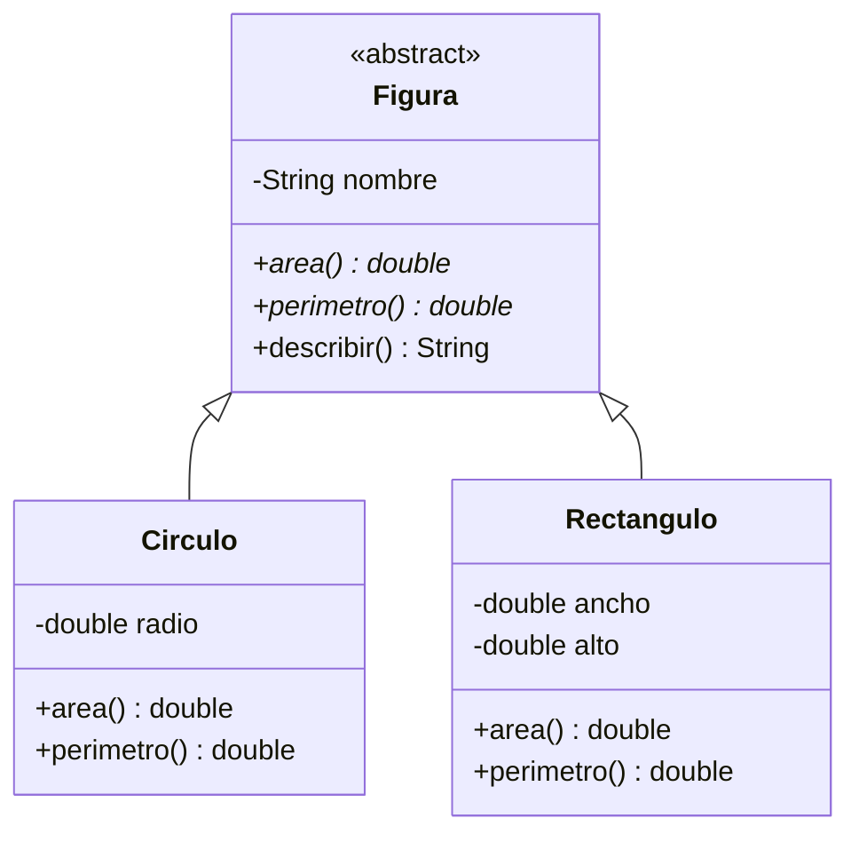
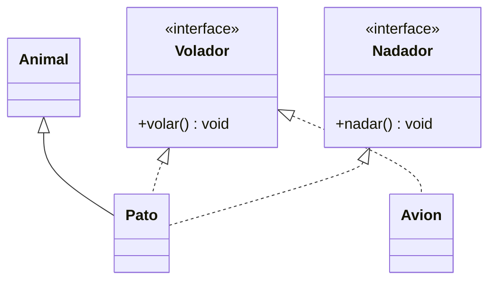

# Tema 14 · Abstracción e interfaces

[⬅️ Tema anterior](../13-herencia-y-polimorfismo/README.md) · [🏠 Índice](../../INDICE.md) · [Siguiente tema ➡️](../15-excepciones/README.md)

En el tema 13 creamos una clase `Figura` cuyo `area()` devolvía 0, y nada impedía escribir `new Figura()`, que no representa nada real. La **abstracción** consiste en quedarse con lo esencial: una figura **tiene** un área, aunque cada tipo de figura la calcule a su manera. En Java se expresa con **clases abstractas** y con **interfaces**, dos de las herramientas más importantes para diseñar programas flexibles.

## 🎯 Objetivos

- Crear **clases y métodos abstractos**.
- Definir **interfaces** e implementarlas con `implements`.
- Usar interfaces como **tipos** para conseguir polimorfismo.
- Escribir métodos **`default`** y **`static`** en interfaces.
- Ordenar objetos implementando **`Comparable`**.
- Elegir entre **clase abstracta** e **interfaz**.
- Restringir jerarquías con clases e interfaces **`sealed`**.
- Conocer las **clases anónimas**.

## 📚 Contenido

1. [Abstracción](#1-abstracción)
2. [Clases abstractas](#2-clases-abstractas)
3. [Interfaces](#3-interfaces)
4. [Implementar varias interfaces](#4-implementar-varias-interfaces)
5. [Interfaces como tipo](#5-interfaces-como-tipo)
6. [Métodos default y static](#6-métodos-default-y-static)
7. [Comparable: objetos que se pueden ordenar](#7-comparable-objetos-que-se-pueden-ordenar)
8. [¿Clase abstracta o interfaz?](#8-clase-abstracta-o-interfaz)
9. [Clases e interfaces sealed](#9-clases-e-interfaces-sealed)
10. [Clases anónimas](#10-clases-anónimas)
11. [Errores típicos](#11-errores-típicos)
12. [Resumen](#12-resumen)

---

## 1. Abstracción

**Abstraer** es fijarse en **qué** hace algo y olvidarse de **cómo** lo hace. Cuando conduces, usas el volante y los pedales sin pensar en el motor: el coche te ofrece una abstracción.

En programación, la abstracción permite escribir código que trabaja con **ideas generales** ("cualquier figura", "cualquier cosa que se pueda pagar", "cualquier cosa ordenable") en lugar de con clases concretas. Java ofrece dos herramientas:

| Herramienta | Expresa | Relación |
|---|---|---|
| **Clase abstracta** | Una **base común incompleta**: "todo animal tiene nombre y emite un sonido, pero cada uno el suyo" | "Es un" (herencia) |
| **Interfaz** | Un **contrato** de capacidades: "esto se puede encender", "esto se puede comparar" | "Puede hacer" |

## 2. Clases abstractas

Una clase **abstracta** no se puede instanciar: sirve solo como base para sus subclases. Puede tener **métodos abstractos**, que se declaran sin cuerpo y que las subclases están **obligadas** a implementar.

```java
abstract class Figura {
    private final String nombre;

    protected Figura(String nombre) {     // Puede tener constructor (para las subclases)
        this.nombre = nombre;
    }

    public abstract double area();        // Método abstracto: SIN cuerpo, con ;
    public abstract double perimetro();

    public String describir() {           // También métodos normales
        return nombre + " de área " + area();
    }
}

class Circulo extends Figura {
    private final double radio;

    public Circulo(double radio) {
        super("Círculo");
        this.radio = radio;
    }

    @Override
    public double area() {                // OBLIGATORIO implementarlo
        return Math.PI * radio * radio;
    }

    @Override
    public double perimetro() {
        return 2 * Math.PI * radio;
    }
}

// Figura f = new Figura("?");   // ❌ Error: Figura is abstract; cannot be instantiated
Figura f = new Circulo(2);        // ✅ Una variable de tipo abstracto, con un objeto concreto
```

| Una clase abstracta... | |
|---|---|
| ¿Se puede instanciar con `new`? | **No** |
| ¿Puede tener atributos, constructores y métodos normales? | Sí |
| ¿Puede tener métodos abstractos? | Sí (y si tiene alguno, la clase **debe** ser abstracta) |
| ¿Qué pasa si una subclase no implementa todos los métodos abstractos? | No compila, salvo que también sea abstracta |
| ¿Sirve como tipo de variable, parámetro o array? | Sí: es la base del polimorfismo |



(En los diagramas, el `*` marca los métodos abstractos.)

## 3. Interfaces

Una **interfaz** define un **contrato**: una lista de métodos que una clase se **compromete** a ofrecer. No dice **cómo** se hacen, solo **qué** se puede hacer.

```java
interface Encendible {
    void encender();                   // Sin cuerpo: son abstractos y public por defecto
    void apagar();
    boolean estaEncendido();
}

class Lampara implements Encendible {  // implements: se compromete a cumplir el contrato
    private boolean encendida;

    @Override
    public void encender() {
        encendida = true;
    }

    @Override
    public void apagar() {
        encendida = false;
    }

    @Override
    public boolean estaEncendido() {
        return encendida;
    }
}
```

- Los métodos de una interfaz son **`public`** y **`abstract`** por defecto (no hace falta escribirlo). Al implementarlos, hay que declararlos `public`.
- Una interfaz **no tiene atributos** de instancia. Solo puede tener **constantes** (que son `public static final` automáticamente).
- No se puede instanciar: `new Encendible()` no compila.
- Por convención, el nombre de una interfaz suele ser un adjetivo ("-ble"): `Comparable`, `Encendible`, `Recargable`... o un sustantivo que describe un papel: `MetodoPago`, `Lista`.

## 4. Implementar varias interfaces

Una clase solo puede **heredar de una** clase, pero puede **implementar todas las interfaces** que quiera. Así un objeto puede tener varias "capacidades":

```java
interface Volador {
    void volar();
}

interface Nadador {
    void nadar();
}

class Pato extends Animal implements Volador, Nadador {
    @Override
    public void volar() { ... }

    @Override
    public void nadar() { ... }
}
```



Fíjate en `Avion`: no es un animal, pero también **puede volar**. Las interfaces agrupan clases que no tienen nada que ver en la jerarquía, pero comparten una capacidad.

Una interfaz también puede **heredar** de otras interfaces con `extends`: `interface Anfibio extends Volador, Nadador { }`.

## 5. Interfaces como tipo

Igual que una superclase, una interfaz se puede usar como tipo de una variable, un parámetro o un array. Así se escribe código que funciona con **cualquier objeto que cumpla el contrato**:

```java
Volador[] voladores = { new Pato("Donald"), new Avion("EC-123"), new Dron() };

for (Volador v : voladores) {
    v.volar();                         // Cada uno, a su manera
}

static void despegarTodos(Volador[] lista) { ... }
```

Lo que se puede llamar depende, como siempre, del tipo de la variable: con una variable `Volador` solo están disponibles los métodos de `Volador`.

Programar "contra interfaces" en lugar de contra clases concretas es uno de los principios de diseño más importantes: tu código depende de **lo que se puede hacer**, no de **quién lo hace**, y puedes cambiar la implementación sin tocar el resto del programa.

## 6. Métodos default y static

Desde Java 8, una interfaz puede incluir métodos **con cuerpo**:

```java
interface Recargable {
    int getBateria();                    // Abstracto: cada clase lo implementa
    void cargar(int porcentaje);

    default boolean necesitaCarga() {    // DEFAULT: implementación por defecto, se puede sobrescribir
        return getBateria() < 20;
    }

    static String nivelATexto(int nivel) {   // STATIC: se llama con el nombre de la interfaz
        return nivel + "%";
    }
}

movil.necesitaCarga();                   // Usa la versión default (o la suya si la sobrescribe)
Recargable.nivelATexto(85);              // "85%"
```

| Tipo de método en una interfaz | ¿Tiene cuerpo? | ¿Lo heredan las clases? | Para qué |
|---|---|---|---|
| Abstracto (normal) | No | Hay que implementarlo | El contrato |
| `default` | Sí | Sí (y se puede sobrescribir) | Comportamiento común basado en el contrato; añadir métodos sin romper las clases existentes |
| `static` | Sí | No: `Interfaz.metodo()` | Utilidades relacionadas con la interfaz |
| `private` (Java 9+) | Sí | No | Código de ayuda para los `default` |

Un método `default` puede usar los métodos abstractos de la interfaz (como `necesitaCarga` usa `getBateria`), pero **no** puede usar atributos, porque las interfaces no los tienen.

## 7. Comparable: objetos que se pueden ordenar

`Arrays.sort` sabe ordenar números y textos, pero ¿cómo ordena alumnos? ¿Por nombre? ¿Por nota? Hay que decírselo implementando la interfaz **`Comparable`** del JDK:

```java
class Alumno implements Comparable<Alumno> {
    private final String nombre;
    private final double nota;

    @Override
    public int compareTo(Alumno otro) {
        return Double.compare(otro.nota, this.nota);   // De mayor a menor nota
    }
}

Alumno[] clase = { ... };
Arrays.sort(clase);                                    // Usa compareTo
```

`compareTo` devuelve un `int` que indica el orden entre `this` y `otro`:

| Resultado | Significa |
|---|---|
| **Negativo** | `this` va **antes** que `otro` |
| **0** | Son equivalentes en el orden |
| **Positivo** | `this` va **después** que `otro` |

- `<Alumno>` indica **con qué tipo** se compara. Es un **genérico**, que verás en el [tema 17](../17-genericos/README.md).
- Para comparar números usa `Integer.compare(a, b)` y `Double.compare(a, b)` (no la resta, que puede desbordar con enteros grandes). Para textos, `a.compareTo(b)`, como en el tema 09.
- Para ordenar de mayor a menor, se intercambian los argumentos: `Double.compare(otro.nota, this.nota)`.
- Para desempatar, se compara un segundo criterio cuando el primero da 0.

En el [tema 19](../19-lambdas-y-streams/README.md) verás `Comparator`, que permite ordenar el mismo tipo de objetos de **varias** formas distintas sin tocar la clase.

## 8. ¿Clase abstracta o interfaz?

| | Clase abstracta | Interfaz |
|---|---|---|
| Relación | "Es un" | "Puede hacer" |
| ¿Cuántas puede tener una clase? | **Una** (`extends`) | **Varias** (`implements`) |
| ¿Atributos de instancia? | Sí | No (solo constantes) |
| ¿Constructores? | Sí | No |
| ¿Métodos con cuerpo? | Sí | Solo `default`, `static` y `private` |
| Visibilidad de los métodos | Cualquiera | `public` (salvo los `private` auxiliares) |
| Úsala cuando... | Las subclases comparten **estado** (atributos) y **código** | Quieres definir una **capacidad** que pueden tener clases sin relación entre sí |

Es muy habitual **combinarlas**: una interfaz define el contrato, y una clase abstracta implementa la parte común para que las clases concretas solo escriban lo específico.

```java
interface MetodoPago { boolean pagar(double importe); }

abstract class PagoConSaldo implements MetodoPago {   // Implementa parte del contrato
    protected double saldo;
    ...
}

class Bizum extends PagoConSaldo { ... }              // Solo lo específico
```

## 9. Clases e interfaces sealed

Desde Java 17, una clase o interfaz **`sealed`** (sellada) indica **exactamente qué clases** pueden heredar de ella o implementarla:

```java
sealed interface Forma permits Circulo, Cuadrado, Triangulo { }

final class Circulo implements Forma { ... }
final class Cuadrado implements Forma { ... }
final class Triangulo implements Forma { ... }
// class Hexagono implements Forma { }   // ❌ Error: no está en la lista "permits"
```

- Cada clase permitida debe ser `final` (nadie más hereda de ella), `sealed` (con su propia lista) o `non-sealed` (abierta de nuevo).
- Sirve para modelar un conjunto **cerrado** de posibilidades: los tipos de forma, los estados de un pedido, los resultados de una operación...

Su gran ventaja aparece con el **`switch` con patrones** (tema 13): como el compilador conoce **todos** los casos posibles, no hace falta `default`, y si algún día se añade un caso nuevo, el compilador avisa de cada `switch` que no lo trata.

```java
double area = switch (forma) {
    case Circulo c -> Math.PI * c.radio() * c.radio();
    case Cuadrado q -> q.lado() * q.lado();
    case Triangulo t -> t.base() * t.altura() / 2;
};   // Sin default: el compilador sabe que no hay más casos
```

## 10. Clases anónimas

A veces se necesita un objeto que implemente una interfaz **una sola vez**, y crear una clase con nombre para eso es excesivo. Una **clase anónima** se define y se instancia en el mismo sitio:

```java
Saludo formal = new Saludo() {           // "Un objeto de una clase sin nombre que implementa Saludo"
    @Override
    public String saludar(String nombre) {
        return "Buenos días, " + nombre;
    }
};

System.out.println(formal.saludar("Ana"));
```

Fueron muy habituales durante años, sobre todo para `Comparable`/`Comparator` y para eventos. Hoy, cuando la interfaz tiene **un solo método abstracto**, se usan las **lambdas** (tema 19), que hacen lo mismo con mucho menos código.

## 11. Errores típicos

| Error | Ejemplo | Qué pasa |
|---|---|---|
| Instanciar una clase abstracta o una interfaz | `new Figura()` | `is abstract; cannot be instantiated` |
| Método abstracto con cuerpo | `abstract double area() { ... }` | Error de compilación |
| Método abstracto en una clase no abstracta | `class Figura { abstract double area(); }` | `Figura is not abstract and does not override abstract method` |
| No implementar todos los métodos | Falta `perimetro()` en `Circulo` | `Circulo is not abstract and does not override abstract method perimetro()` |
| Implementar un método de interfaz sin `public` | `void encender() { }` | `attempting to assign weaker access privileges` |
| Atributos en una interfaz | `int bateria;` | Es una constante (`public static final`): no se puede cambiar |
| `extends` con una interfaz o `implements` con una clase | `class Pato implements Animal` | Error de compilación |
| `compareTo` que resta `double` | `return (int) (this.nota - otro.nota);` | 7.8 − 7.5 = 0.3 → 0: los considera iguales |
| Implementar una interfaz `sealed` sin estar en `permits` | | Error de compilación |

## 12. Resumen

- Una **clase abstracta** (`abstract class`) no se instancia; sus **métodos abstractos** obligan a las subclases a implementarlos. Puede tener atributos, constructores y métodos normales.
- Una **interfaz** es un **contrato** de métodos públicos; una clase la cumple con `implements` y puede implementar **varias**.
- Las interfaces y las clases abstractas sirven como **tipos**: el código que las usa funciona con cualquier implementación.
- Los métodos **`default`** dan una implementación por defecto; los **`static`** son utilidades de la interfaz.
- **`Comparable<T>`** y `compareTo` permiten que `Arrays.sort` ordene tus objetos.
- Clase abstracta para "es un" con estado común; interfaz para "puede hacer". Se combinan a menudo.
- **`sealed`** + `permits` define una jerarquía cerrada, ideal con `switch` de patrones.

---

## 💻 Ejemplos de código

| Archivo | Qué muestra |
|---|---|
| [T14_01_ClasesAbstractas.java](ejemplos/T14_01_ClasesAbstractas.java) | Clases y métodos abstractos, y por qué no se pueden instanciar |
| [T14_02_Interfaces.java](ejemplos/T14_02_Interfaces.java) | Definir interfaces, implementar varias y usarlas como tipo |
| [T14_03_DefaultYStatic.java](ejemplos/T14_03_DefaultYStatic.java) | Métodos `default`, `static` y `private` en interfaces |
| [T14_04_Comparable.java](ejemplos/T14_04_Comparable.java) | Ordenar objetos con `Comparable` y `Arrays.sort` |
| [T14_05_Sealed.java](ejemplos/T14_05_Sealed.java) | Jerarquías `sealed` y `switch` exhaustivo |
| [T14_06_CombinarYAnonimas.java](ejemplos/T14_06_CombinarYAnonimas.java) | Interfaz + clase abstracta, y clases anónimas |

## ✏️ Ejercicios

Practica lo aprendido en los [ejercicios del tema 14](../../ejercicios/14-abstraccion-e-interfaces/README.md).

---

[⬅️ Tema anterior](../13-herencia-y-polimorfismo/README.md) · [🏠 Índice](../../INDICE.md) · [Siguiente tema ➡️](../15-excepciones/README.md)
