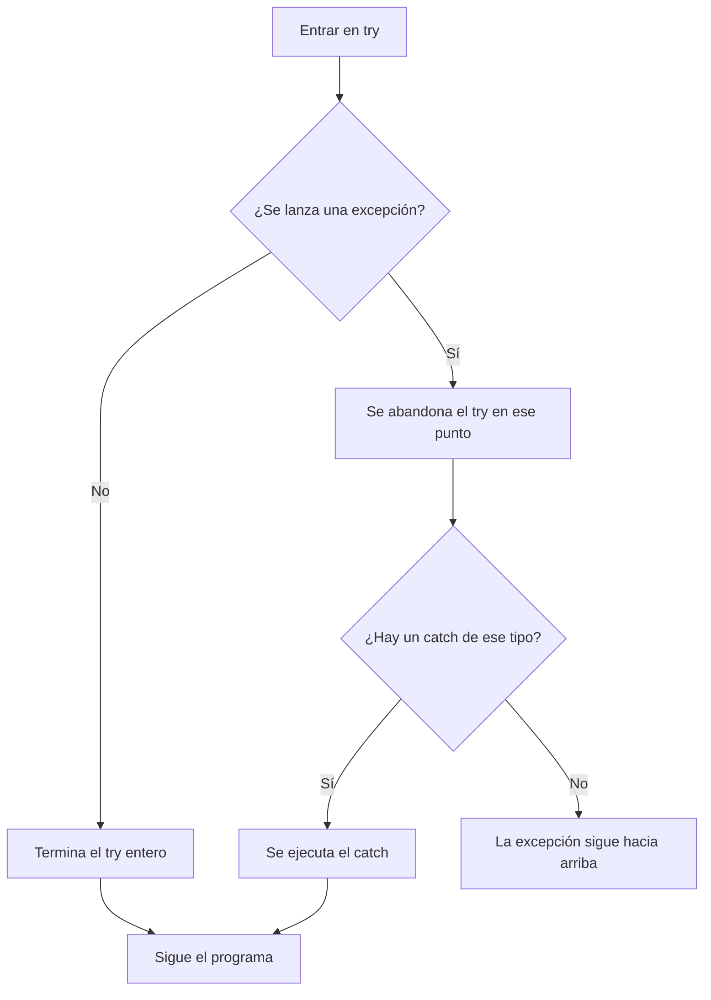
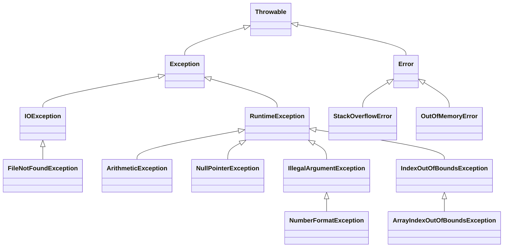
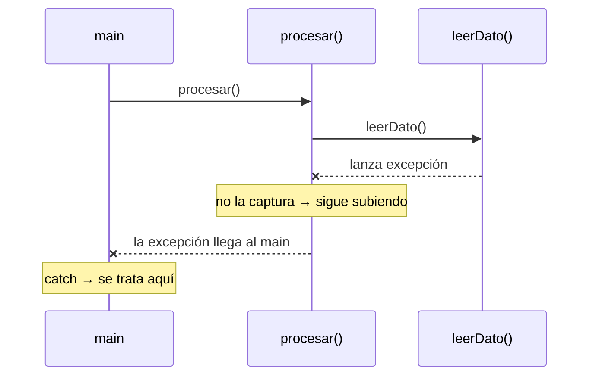

# Tema 15 · Excepciones

[⬅️ Tema anterior](../14-abstraccion-e-interfaces/README.md) · [🏠 Índice](../../INDICE.md) · [Siguiente tema ➡️](../16-colecciones/README.md)

Desde el tema 02 te has encontrado con mensajes como `ArithmeticException: / by zero` o `NumberFormatException`, que detenían el programa en seco. Esos son **excepciones**: la forma que tiene Java de avisar de que algo ha ido mal. En este tema aprenderás a **capturarlas** para que el programa se recupere, a **lanzarlas** tú mismo cuando detectes un error y a crear las **tuyas propias**.

## 🎯 Objetivos

- Entender qué es una excepción y leer una **traza de error** (*stack trace*).
- Capturar excepciones con **`try`**, **`catch`** y **`finally`**.
- Conocer la **jerarquía** de excepciones y la diferencia entre **checked** y **unchecked**.
- **Lanzar** excepciones con `throw` y declararlas con `throws`.
- Crear **excepciones propias**.
- Cerrar recursos automáticamente con **try-with-resources**.
- Aplicar **buenas prácticas** en el manejo de errores.

## 📚 Contenido

1. [¿Qué es una excepción?](#1-qué-es-una-excepción)
2. [Leer una traza de error](#2-leer-una-traza-de-error)
3. [try y catch](#3-try-y-catch)
4. [Varios catch y multi-catch](#4-varios-catch-y-multi-catch)
5. [finally](#5-finally)
6. [La jerarquía de excepciones](#6-la-jerarquía-de-excepciones)
7. [Checked y unchecked](#7-checked-y-unchecked)
8. [Lanzar excepciones: throw](#8-lanzar-excepciones-throw)
9. [Propagar excepciones: throws](#9-propagar-excepciones-throws)
10. [Excepciones propias](#10-excepciones-propias)
11. [try-with-resources](#11-try-with-resources)
12. [Buenas prácticas](#12-buenas-prácticas)
13. [Errores típicos](#13-errores-típicos)
14. [Resumen](#14-resumen)

---

## 1. ¿Qué es una excepción?

Una **excepción** es un objeto que representa un **error durante la ejecución**: dividir entre cero, usar un índice que no existe, convertir `"hola"` en número, abrir un fichero que no está... Cuando ocurre, Java **lanza** la excepción: interrumpe lo que estaba haciendo y busca a alguien que la **capture**. Si nadie lo hace, el programa termina mostrando el error.

```java
int[] numeros = {1, 2, 3};
System.out.println("Antes");
System.out.println(numeros[5]);    // 💥 Se lanza ArrayIndexOutOfBoundsException
System.out.println("Después");     // Nunca se ejecuta
```

Ya conoces varias:

| Excepción | Cuándo ocurre | Tema |
|---|---|---|
| `ArithmeticException` | División entera entre 0 | 02, 04 |
| `NumberFormatException` | `Integer.parseInt("hola")` | 03 |
| `InputMismatchException` | `nextInt()` cuando se escribe texto | 05 |
| `ArrayIndexOutOfBoundsException` | Índice fuera del array | 08 |
| `StringIndexOutOfBoundsException` | Índice fuera del texto | 09 |
| `NullPointerException` | Usar un método o atributo sobre `null` | 09, 11 |
| `ClassCastException` | Casting a un tipo incorrecto | 13 |
| `StackOverflowError` | Recursividad sin caso base | 10 |

## 2. Leer una traza de error

Cuando una excepción no se captura, Java muestra su **traza** (*stack trace*): qué ha pasado y por dónde ha ido pasando el programa.

```
Exception in thread "main" java.lang.NumberFormatException: For input string: "doce"
	at java.base/java.lang.Integer.parseInt(Integer.java:661)
	at Notas.leerNota(Notas.java:14)
	at Notas.main(Notas.java:6)
```

| Parte | Qué dice |
|---|---|
| `NumberFormatException` | **Qué** tipo de error |
| `For input string: "doce"` | El **mensaje**: detalles del error |
| `at Notas.leerNota(Notas.java:14)` | **Dónde**: en el método `leerNota`, línea 14 |
| `at Notas.main(Notas.java:6)` | **Quién** llamó a ese método: `main`, línea 6 |

Se lee **de arriba abajo**: la primera línea de **tu** código (no de las clases de Java) suele ser el mejor sitio para empezar a buscar el fallo.

## 3. try y catch

Para que el programa no se detenga, el código que puede fallar se pone dentro de un bloque **`try`**, y lo que hay que hacer si falla, en un bloque **`catch`**:

```java
try {
    int edad = Integer.parseInt(texto);       // Puede lanzar NumberFormatException
    System.out.println("Edad: " + edad);       // Solo si la línea anterior ha ido bien
} catch (NumberFormatException e) {
    System.out.println("'" + texto + "' no es un número");
}
System.out.println("El programa sigue");      // Se ejecuta siempre
```



- En cuanto una instrucción del `try` lanza una excepción, **el resto del `try` no se ejecuta**: se salta directamente al `catch`.
- `e` es el **objeto excepción**. Sus métodos más útiles son `e.getMessage()` (el mensaje) y `e.printStackTrace()` (la traza completa, útil al depurar).
- Las variables declaradas **dentro** del `try` no existen fuera (como en cualquier bloque).

### Un caso típico: leer números sin que el programa falle

```java
int numero = 0;
boolean valido = false;
while (!valido) {
    System.out.print("Número: ");
    try {
        numero = Integer.parseInt(teclado.nextLine());
        valido = true;
    } catch (NumberFormatException e) {
        System.out.println("  Eso no es un número entero");
    }
}
```

## 4. Varios catch y multi-catch

Un `try` puede tener **varios `catch`**, uno por tipo de error. Java elige el **primero que encaje**:

```java
try {
    int indice = Integer.parseInt(texto);
    System.out.println(10 / datos[indice]);
} catch (NumberFormatException e) {
    System.out.println("No es un número");
} catch (ArrayIndexOutOfBoundsException e) {
    System.out.println("Esa posición no existe");
} catch (ArithmeticException e) {
    System.out.println("No se puede dividir entre 0");
}
```

Si varios tipos se tratan **igual**, se pueden agrupar con `|` (**multi-catch**):

```java
} catch (NumberFormatException | ArrayIndexOutOfBoundsException e) {
    System.out.println("Posición no válida: " + e.getMessage());
}
```

⚠️ **El orden importa**: los tipos más **concretos** van antes que los más **generales**. Como `NumberFormatException` es una subclase de `IllegalArgumentException`, si pones primero `catch (IllegalArgumentException e)`, el compilador da error en el segundo porque nunca podría alcanzarse.

## 5. finally

El bloque **`finally`** se ejecuta **siempre**: haya excepción o no, se capture o no, e incluso si hay un `return` dentro del `try`.

```java
try {
    abrirConexion();
    enviarDatos();
} catch (IOException e) {
    System.out.println("Error al enviar: " + e.getMessage());
} finally {
    cerrarConexion();     // Pase lo que pase, se cierra
}
```

Sirve para **liberar recursos** (cerrar ficheros, conexiones...). Hoy en día, para eso se prefiere **try-with-resources** (sección 11), pero `finally` sigue siendo útil para tareas de "limpieza" que no son un recurso.

## 6. La jerarquía de excepciones

Las excepciones son **clases**, organizadas con herencia (tema 13):



| Rama | Qué representa | ¿Se captura? |
|---|---|---|
| `Error` | Problemas graves de la JVM (sin memoria, pila desbordada) | **No**: no hay forma razonable de recuperarse |
| `Exception` | Problemas que un programa **puede** prever y tratar | Sí |
| `RuntimeException` | Errores de **programación** (índices, `null`, divisiones...) | Se pueden capturar, pero lo ideal es **evitarlos** |

Gracias a la herencia, un `catch (IndexOutOfBoundsException e)` captura también `ArrayIndexOutOfBoundsException` y `StringIndexOutOfBoundsException` (polimorfismo).

## 7. Checked y unchecked

Java distingue dos tipos de excepciones:

| | **Unchecked** (no comprobadas) | **Checked** (comprobadas) |
|---|---|---|
| Clases | `RuntimeException` y sus subclases (y `Error`) | El resto de `Exception` |
| ¿El compilador obliga a tratarlas? | No | **Sí**: hay que capturarlas o declararlas con `throws` |
| Representan... | Errores de programación que se deberían evitar | Situaciones externas que pueden pasar aunque el código sea correcto |
| Ejemplos | `NullPointerException`, `IllegalArgumentException` | `IOException`, `FileNotFoundException`, `InterruptedException` |

```java
// ❌ No compila: Thread.sleep puede lanzar InterruptedException (checked)
Thread.sleep(1000);

// ✅ Se captura...
try {
    Thread.sleep(1000);
} catch (InterruptedException e) {
    System.out.println("Me han interrumpido");
}

// ✅ ...o se declara en la cabecera del método (sección 9)
static void esperar() throws InterruptedException {
    Thread.sleep(1000);
}
```

La idea es que, si algo **puede fallar aunque tu código esté bien** (el disco está lleno, el fichero no existe, la red se cae), el compilador te obliga a **pensar** qué hacer en ese caso. Verás muchas checked en el [tema 20 · Ficheros](../20-ficheros/README.md).

## 8. Lanzar excepciones: throw

Tú también puedes lanzar excepciones con **`throw`**. Es la forma profesional de rechazar datos no válidos, en lugar de mostrar mensajes o devolver `false` como en el tema 12:

```java
public void setEdad(int edad) {
    if (edad < 0 || edad > 150) {
        throw new IllegalArgumentException("Edad no válida: " + edad);
    }
    this.edad = edad;
}
```

- `throw` **interrumpe** el método inmediatamente, como un `return`, pero en lugar de devolver un valor lanza la excepción a quien lo llamó.
- Así el objeto **nunca** queda en un estado incorrecto, y quien lo usa **no puede ignorar** el error sin darse cuenta.

Excepciones del JDK que conviene usar:

| Excepción | Úsala cuando... |
|---|---|
| `IllegalArgumentException` | Un **argumento** no es válido (`setEdad(-3)`, `new Fraccion(1, 0)`) |
| `IllegalStateException` | El objeto no está en un **estado** que permita la operación (sacar dinero de una cuenta bloqueada) |
| `NullPointerException` | Se recibe `null` donde no se admite (mejor con `Objects.requireNonNull(x, "mensaje")`) |
| `UnsupportedOperationException` | Una operación no está permitida en ese objeto |

## 9. Propagar excepciones: throws

Si un método no sabe qué hacer con una excepción, puede **dejarla pasar** a quien lo llamó. Con las **checked** es obligatorio indicarlo en la cabecera con **`throws`**:

```java
static String leerPrimeraLinea(String ruta) throws IOException {   // "Esto puede lanzar IOException"
    ...
}

public static void main(String[] args) {
    try {
        System.out.println(leerPrimeraLinea("datos.txt"));
    } catch (IOException e) {
        System.out.println("No se pudo leer el fichero: " + e.getMessage());
    }
}
```

Una excepción **sube** por la pila de llamadas hasta que algún método la captura. Si llega al `main` y tampoco la captura, el programa termina.



¿Dónde capturar? Donde **se pueda hacer algo útil** con el error: mostrar un mensaje al usuario, volver a preguntar, usar un valor por defecto... Normalmente, cerca de la interfaz con el usuario (el `main` o el menú), no en lo más profundo del programa.

`throw` y `throws` son distintos:

| | `throw` | `throws` |
|---|---|---|
| ¿Dónde va? | Dentro del cuerpo del método | En la cabecera del método |
| ¿Qué hace? | **Lanza** una excepción concreta | **Avisa** de que el método puede lanzarla |
| Ejemplo | `throw new IllegalArgumentException("...")` | `void leer() throws IOException` |

## 10. Excepciones propias

Para errores específicos de tu programa, puedes crear tus propias clases de excepción **heredando** de `Exception` (checked) o de `RuntimeException` (unchecked):

```java
class SaldoInsuficienteException extends Exception {
    private final double faltan;

    public SaldoInsuficienteException(double faltan) {
        super("Saldo insuficiente: faltan " + faltan + " €");   // El mensaje de getMessage()
        this.faltan = faltan;
    }

    public double getFaltan() {
        return faltan;
    }
}

public void retirar(double cantidad) throws SaldoInsuficienteException {
    if (cantidad > saldo) {
        throw new SaldoInsuficienteException(cantidad - saldo);
    }
    saldo -= cantidad;
}
```

- El nombre termina en `Exception` por convención.
- Llamando a `super(mensaje)` se fija el texto que devolverá `getMessage()`.
- Pueden tener **atributos** con información útil para quien la capture (aquí, cuánto falta).

¿Checked o unchecked? Si quien llama **debe** tratar ese caso porque es una situación normal del negocio (no hay saldo, el producto está agotado), **checked**. Si es un uso incorrecto que el programador debería haber evitado, **unchecked**.

## 11. try-with-resources

Muchos objetos usan **recursos** que hay que cerrar al terminar: un `Scanner`, un fichero, una conexión... Con **try-with-resources**, Java los cierra **automáticamente** al salir del bloque, haya error o no:

```java
try (Scanner lector = new Scanner(texto)) {      // El recurso se declara entre paréntesis
    while (lector.hasNextLine()) {
        System.out.println(lector.nextLine());
    }
}   // Aquí se llama a lector.close() automáticamente
```

- Funciona con cualquier objeto que implemente la interfaz **`AutoCloseable`** (tema 14).
- Se pueden declarar varios recursos separados por `;`. Se cierran en **orden inverso** al de apertura.
- Puede llevar `catch` y `finally` como un `try` normal.
- Es la forma recomendada de trabajar con ficheros (tema 20).

> Recuerda el aviso del tema 05: cerrar un `Scanner` de `System.in` cierra también el teclado. Por eso, con el teclado, el `Scanner` se suele cerrar solo al final del programa.

## 12. Buenas prácticas

| ✅ Haz | ❌ Evita |
|---|---|
| Capturar el tipo **concreto** que esperas | `catch (Exception e)` para todo "por si acaso" |
| Mostrar o registrar un mensaje útil | Un `catch` vacío que se "traga" el error |
| Validar **antes** cuando es fácil (`if (divisor != 0)`, `hasNextInt()`) | Usar excepciones para el flujo normal del programa |
| Lanzar excepciones con mensajes **claros** (qué falló y con qué valor) | `throw new Exception("Error")` |
| Capturar donde se pueda **hacer algo** con el error | Capturar en todos los métodos y relanzar sin motivo |
| Usar try-with-resources para recursos | Olvidar cerrar ficheros y conexiones |

```java
// ❌ Lo peor que se puede hacer: el error desaparece sin dejar rastro
try {
    procesar();
} catch (Exception e) {
}
```

> **Excepciones y la regla del repositorio:** una excepción también interrumpe un bucle de golpe. Eso es correcto cuando se trata de un **error**, pero no las uses como sustituto de `break` para terminar un bucle en una situación normal: para eso siguen estando las banderas.

## 13. Errores típicos

| Error | Ejemplo | Qué pasa |
|---|---|---|
| No tratar una checked | `Thread.sleep(1000);` sin `try` ni `throws` | `unreported exception InterruptedException; must be caught or declared to be thrown` |
| `catch` general antes que el concreto | `catch (Exception e)` y después `catch (IOException e)` | `exception IOException has already been caught` |
| Usar fuera del `try` una variable declarada dentro | | `cannot find symbol` |
| `catch` vacío | | Los errores pasan desapercibidos |
| Confundir `throw` y `throws` | `void f() throw IOException` | Error de compilación |
| Olvidar `new` al lanzar | `throw IllegalArgumentException("...")` | Error de compilación |
| Capturar `Error` o `StackOverflowError` | | Ocultas un problema grave en lugar de arreglarlo |
| Lanzar `Exception` genérica | `throw new Exception("algo falló")` | Obliga a capturar algo poco concreto; usa un tipo específico |

## 14. Resumen

- Una **excepción** es un objeto que representa un error en tiempo de ejecución; la **traza** dice qué pasó y dónde.
- **`try`** contiene el código que puede fallar; **`catch`** trata cada tipo de error; **`finally`** se ejecuta siempre.
- Varios `catch` de lo **concreto** a lo **general**; **multi-catch** con `|`.
- **Unchecked** (`RuntimeException`): errores de programación, no obligan a tratarlas. **Checked**: el compilador obliga a **capturarlas** o **declararlas** con `throws`.
- **`throw`** lanza una excepción (por ejemplo, `IllegalArgumentException` para datos no válidos).
- Las **excepciones propias** heredan de `Exception` o de `RuntimeException`.
- **try-with-resources** cierra automáticamente los recursos `AutoCloseable`.
- Captura lo concreto, nunca dejes un `catch` vacío y no uses excepciones para el flujo normal.

---

## 💻 Ejemplos de código

| Archivo | Qué muestra |
|---|---|
| [T15_01_QueEsUnaExcepcion.java](ejemplos/T15_01_QueEsUnaExcepcion.java) | Las excepciones más comunes, capturadas, con su tipo y mensaje |
| [T15_02_TryCatchFinally.java](ejemplos/T15_02_TryCatchFinally.java) | Varios `catch`, multi-catch, `finally` y el orden de ejecución |
| [T15_03_LeerDatosSeguro.java](ejemplos/T15_03_LeerDatosSeguro.java) | Leer números del teclado sin que el programa falle |
| [T15_04_ThrowYThrows.java](ejemplos/T15_04_ThrowYThrows.java) | Lanzar excepciones para validar, propagarlas y checked frente a unchecked |
| [T15_05_ExcepcionesPropias.java](ejemplos/T15_05_ExcepcionesPropias.java) | Crear y usar excepciones propias con información extra |
| [T15_06_TryWithResources.java](ejemplos/T15_06_TryWithResources.java) | Cierre automático de recursos y orden de cierre |

> El ejemplo 03 **espera que escribas** datos.

## ✏️ Ejercicios

Practica lo aprendido en los [ejercicios del tema 15](../../ejercicios/15-excepciones/README.md).

---

[⬅️ Tema anterior](../14-abstraccion-e-interfaces/README.md) · [🏠 Índice](../../INDICE.md) · [Siguiente tema ➡️](../16-colecciones/README.md)
