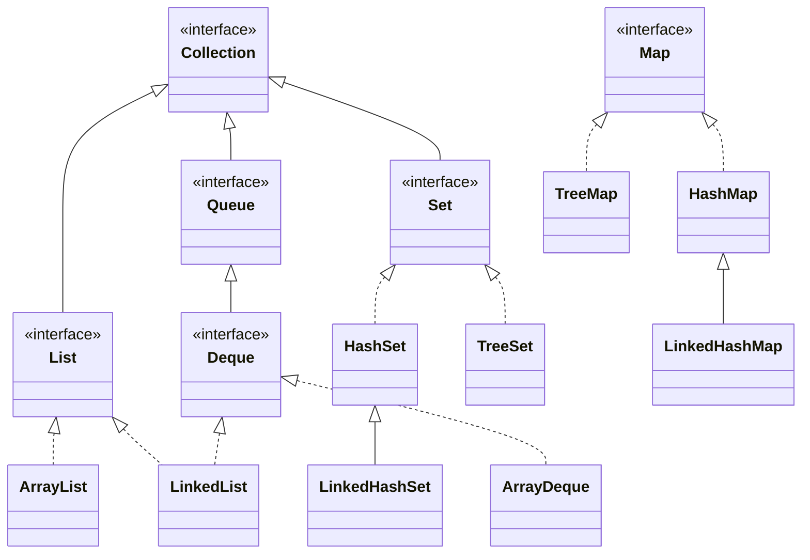
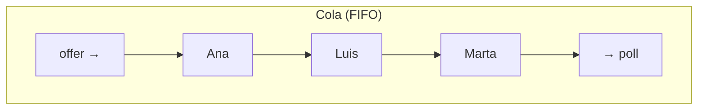
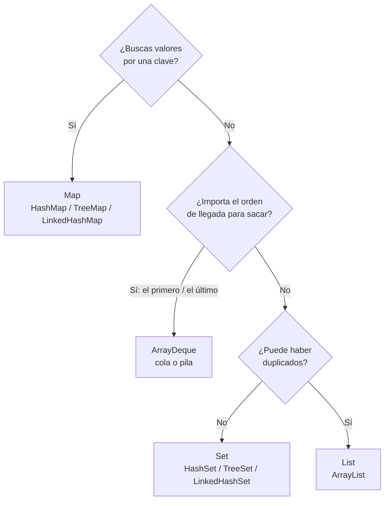

# Tema 16 · Colecciones

[⬅️ Tema anterior](../15-excepciones/README.md) · [🏠 Índice](../../INDICE.md) · [Siguiente tema ➡️](../17-genericos/README.md)

Los arrays del tema 08 tienen un tamaño fijo: si creas `new String[10]` y llega el elemento 11, no cabe. Además, borrar un elemento del medio obliga a desplazar el resto a mano (lo hiciste en la lista de reproducción del tema 11). Las **colecciones** son clases del JDK que resuelven todo eso: crecen solas, saben buscar, borrar, evitar duplicados u ordenar, y están probadas por millones de programadores.

## 🎯 Objetivos

- Entender las limitaciones de los arrays y el papel de las **colecciones**.
- Conocer las interfaces principales: **`List`**, **`Set`**, **`Map`** y **`Deque`**.
- Usar las **clases envoltorio** (`Integer`, `Double`...) y el **autoboxing**.
- Trabajar con **`ArrayList`**: añadir, obtener, modificar, borrar y buscar.
- Recorrer colecciones con `for`, for-each e **`Iterator`**, y borrar mientras se recorre.
- Evitar duplicados con **`HashSet`**, **`LinkedHashSet`** y **`TreeSet`**.
- Asociar claves y valores con **`HashMap`**, **`LinkedHashMap`** y **`TreeMap`**.
- Usar **colas** y **pilas** con `ArrayDeque`.
- Ordenar y analizar listas con la clase **`Collections`**.
- Elegir la colección adecuada para cada problema.

## 📚 Contenido

1. [Más allá de los arrays](#1-más-allá-de-los-arrays)
2. [El mapa de las colecciones](#2-el-mapa-de-las-colecciones)
3. [Clases envoltorio y autoboxing](#3-clases-envoltorio-y-autoboxing)
4. [ArrayList](#4-arraylist)
5. [Recorrer una colección](#5-recorrer-una-colección)
6. [Listas inmutables](#6-listas-inmutables)
7. [Conjuntos: Set](#7-conjuntos-set)
8. [Mapas: Map](#8-mapas-map)
9. [Colas y pilas: Deque](#9-colas-y-pilas-deque)
10. [La clase Collections](#10-la-clase-collections)
11. [¿Qué colección elijo?](#11-qué-colección-elijo)
12. [Errores típicos](#12-errores-típicos)
13. [Resumen](#13-resumen)

---

## 1. Más allá de los arrays

| Necesidad | Con un array | Con una colección |
|---|---|---|
| Añadir un elemento más | Crear un array mayor y copiar | `lista.add(x)` |
| Saber cuántos hay | Llevar un contador aparte | `lista.size()` |
| Borrar uno del medio | Desplazar a mano | `lista.remove(i)` |
| ¿Está este elemento? | Bucle con bandera | `lista.contains(x)` |
| Evitar duplicados | Buscar antes de añadir | Un `Set` lo hace solo |
| Buscar por una clave (DNI → persona) | Arrays paralelos y búsqueda | Un `Map` lo hace solo |

Los arrays siguen siendo útiles cuando el tamaño es fijo y conocido (los días de la semana, un tablero de 3 × 3) y son la base sobre la que se construyen muchas colecciones. Pero en el día a día, la mayoría de los programas Java usan colecciones.

Todas están en el paquete `java.util`, así que hay que importarlas:

```java
import java.util.ArrayList;
import java.util.List;
```

## 2. El mapa de las colecciones

Las colecciones aplican lo que aprendiste en el tema 14: hay **interfaces** que definen **qué** se puede hacer y **clases** que lo implementan de formas distintas.



| Interfaz | Qué es | ¿Orden? | ¿Duplicados? | Ejemplo de uso |
|---|---|---|---|---|
| `List` | Secuencia con posiciones (como un array que crece) | Sí, por posición | Sí | La lista de la compra |
| `Set` | Conjunto de elementos **únicos** | Según la clase | **No** | Los DNI que han votado |
| `Map` | Pares **clave → valor** | Según la clase | Claves únicas | Matrícula → coche |
| `Deque` | Cola o pila: se añade y se saca por los extremos | Por llegada | Sí | Turnos de una consulta |

`Map` no hereda de `Collection` porque guarda **pares**, no elementos sueltos, pero forma parte del mismo "framework".

**El tipo entre `< >`.** Al crear una colección se indica qué guarda:

```java
List<String> nombres = new ArrayList<>();     // Una lista de String
Map<String, Integer> edades = new HashMap<>(); // Claves String, valores Integer
```

Esto se llama **genéricos** y lo estudiarás a fondo en el [tema 17](../17-genericos/README.md). De momento basta con saber que el compilador comprueba que solo metes `String` en `nombres`. El `<>` vacío de la derecha (el *diamante*) significa "el mismo tipo que a la izquierda".

> **Programa contra la interfaz:** declara la variable con el tipo de la interfaz (`List`, `Map`) y crea el objeto con la clase concreta (`ArrayList`, `HashMap`). Así, si un día quieres cambiar de implementación, solo tocas una línea (tema 14, sección 5).

## 3. Clases envoltorio y autoboxing

Las colecciones solo guardan **objetos**, no tipos primitivos. `List<int>` no compila. Para cada primitivo existe una **clase envoltorio** (*wrapper*):

| Primitivo | Envoltorio |
|---|---|
| `int` | `Integer` |
| `double` | `Double` |
| `char` | `Character` |
| `boolean` | `Boolean` |
| `long` | `Long` |

Java convierte entre ambos **automáticamente**:

```java
List<Integer> numeros = new ArrayList<>();
numeros.add(7);                 // autoboxing:   int 7 → Integer
int primero = numeros.get(0);   // unboxing:     Integer → int
```

Ya conocías algunos métodos de estas clases: `Integer.parseInt`, `Double.parseDouble`, `Character.isDigit`...

⚠️ **Cuidado con `==` entre envoltorios:** son objetos, así que `==` compara referencias. Por una optimización interna, funciona "por casualidad" con números pequeños (de -128 a 127) y falla con los demás:

```java
Integer a = 1000;
Integer b = 1000;
System.out.println(a == b);        // false 😱
System.out.println(a.equals(b));   // true ✅
```

Y un `Integer` puede ser `null`: si haces unboxing de un `null` (`int x = mapa.get("no existe");`), obtienes un `NullPointerException`.

## 4. ArrayList

`ArrayList` es la colección más usada: una lista que internamente usa un array y lo agranda cuando hace falta.

```java
List<String> compra = new ArrayList<>();
compra.add("pan");                 // [pan]
compra.add("leche");               // [pan, leche]
compra.add(0, "huevos");           // [huevos, pan, leche]  (inserta en la posición 0)
compra.set(1, "pan integral");     // [huevos, pan integral, leche]
compra.remove("leche");            // [huevos, pan integral]
System.out.println(compra);        // Las colecciones tienen un toString útil
```

| Método | Qué hace |
|---|---|
| `add(e)` / `add(i, e)` | Añade al final / en la posición `i` |
| `get(i)` | Devuelve el elemento de la posición `i` |
| `set(i, e)` | Sustituye el elemento de la posición `i` |
| `remove(i)` / `remove(objeto)` | Borra por posición / la primera aparición del objeto |
| `size()` | Número de elementos |
| `isEmpty()` | ¿Está vacía? |
| `contains(e)` | ¿Está el elemento? (usa `equals`) |
| `indexOf(e)` | Posición de la primera aparición, o `-1` |
| `clear()` | Vacía la lista |
| `addAll(otraColeccion)` | Añade todos los elementos de otra colección |

Las posiciones empiezan en 0, como en los arrays, y acceder fuera de rango lanza `IndexOutOfBoundsException`.

⚠️ **`remove` con `List<Integer>`:** `remove(int)` borra por **posición** y `remove(Object)` borra por **valor**. Con números se confunden fácilmente:

```java
List<Integer> numeros = new ArrayList<>(List.of(10, 20, 30));
numeros.remove(1);                     // Borra la POSICIÓN 1 → [10, 30]
numeros.remove(Integer.valueOf(30));   // Borra el VALOR 30   → [10]
```

`contains`, `indexOf` y `remove(objeto)` usan **`equals`**. Con tus propias clases, funcionan bien solo si has sobrescrito `equals` (tema 13).

## 5. Recorrer una colección

**Con un `for` con índice** (solo listas, porque necesita posiciones):

```java
for (int i = 0; i < compra.size(); i++) {
    System.out.println((i + 1) + ". " + compra.get(i));
}
```

**Con for-each** (cualquier colección; es lo más habitual):

```java
for (String producto : compra) {
    System.out.println(producto);
}
```

**Borrar mientras se recorre.** Si borras dentro de un for-each, Java lanza `ConcurrentModificationException`: la colección ha cambiado "por debajo" del recorrido. Para borrar de forma segura se usa un **`Iterator`**, que es el objeto que usa el for-each por dentro:

```java
Iterator<Integer> it = notas.iterator();
while (it.hasNext()) {             // ¿Quedan elementos?
    int nota = it.next();          // Dame el siguiente
    if (nota < 5) {
        it.remove();               // Borra el último que me has dado (seguro)
    }
}
```

> En el [tema 19](../19-lambdas-y-streams/README.md) verás una forma mucho más corta: `notas.removeIf(n -> n < 5);`.

## 6. Listas inmutables

`List.of(...)` crea una lista **inmutable** en una línea. Es perfecta para datos fijos:

```java
List<String> dias = List.of("lunes", "martes", "miércoles");
dias.add("jueves");   // 💥 UnsupportedOperationException
```

Si necesitas una lista modificable con unos valores iniciales, crea un `ArrayList` a partir de ella:

```java
List<String> tareas = new ArrayList<>(List.of("estudiar", "entrenar"));
tareas.add("leer");   // ✅
```

Existen también `Set.of(...)` y `Map.of(clave1, valor1, clave2, valor2, ...)`, igualmente inmutables.

## 7. Conjuntos: Set

Un `Set` **no admite duplicados**: si añades un elemento que ya está, `add` devuelve `false` y no pasa nada más.

```java
Set<String> visitantes = new HashSet<>();
visitantes.add("Ana");      // true
visitantes.add("Luis");     // true
visitantes.add("Ana");      // false: ya estaba
System.out.println(visitantes.size());   // 2
```

Los conjuntos no tienen posiciones (no hay `get(i)`): se recorren con for-each y se pregunta con `contains`, que es **muy rápido** en un `HashSet` aunque tenga millones de elementos.

| Clase | Orden al recorrer | Cuándo usarla |
|---|---|---|
| `HashSet` | **Ninguno garantizado** | Lo normal: solo te importa si algo está o no |
| `LinkedHashSet` | Orden de **inserción** | Quieres quitar duplicados conservando el orden original |
| `TreeSet` | **Ordenado** (alfabético, numérico o con `Comparable`) | Quieres los elementos ordenados |

**Operaciones de conjuntos:**

```java
Set<String> a = new TreeSet<>(List.of("java", "python", "c"));
Set<String> b = new TreeSet<>(List.of("python", "go"));

Set<String> union = new TreeSet<>(a);
union.addAll(b);             // [c, go, java, python]

Set<String> interseccion = new TreeSet<>(a);
interseccion.retainAll(b);   // [python]

Set<String> diferencia = new TreeSet<>(a);
diferencia.removeAll(b);     // [c, java]
```

Se copia `a` antes de operar porque `addAll`, `retainAll` y `removeAll` **modifican** el conjunto sobre el que se llaman.

⚠️ **Con tus propias clases:** `HashSet` usa **`hashCode` y `equals`** para saber si dos objetos son iguales, y `TreeSet` usa **`compareTo`**. Si no los has sobrescrito (temas 13 y 14), el `HashSet` considerará distintos a dos objetos con los mismos datos y el `TreeSet` lanzará `ClassCastException`.

## 8. Mapas: Map

Un `Map` guarda **pares clave → valor**, como un diccionario: buscas la palabra (clave) y obtienes su definición (valor). Las claves no se repiten; los valores sí pueden repetirse.

```java
Map<String, Integer> stock = new HashMap<>();
stock.put("manzanas", 12);
stock.put("peras", 5);
stock.put("manzanas", 20);                 // La clave ya existe: SUSTITUYE el valor

System.out.println(stock.get("manzanas"));  // 20
System.out.println(stock.get("kiwis"));     // null: no existe
System.out.println(stock.getOrDefault("kiwis", 0));   // 0
```

| Método | Qué hace |
|---|---|
| `put(clave, valor)` | Guarda el par (si la clave ya estaba, sustituye el valor) |
| `get(clave)` | Devuelve el valor, o `null` si la clave no existe |
| `getOrDefault(clave, porDefecto)` | Como `get`, pero devuelve `porDefecto` en lugar de `null` |
| `containsKey(clave)` / `containsValue(valor)` | ¿Existe esa clave / ese valor? |
| `remove(clave)` | Borra el par |
| `size()`, `isEmpty()` | Número de pares / ¿está vacío? |
| `keySet()` | Un `Set` con las claves |
| `values()` | Una colección con los valores |
| `entrySet()` | Un `Set` con los pares (`Map.Entry`), para recorrer claves y valores a la vez |

**El patrón contador** (muy habitual): contar cuántas veces aparece cada cosa.

```java
Map<String, Integer> votos = new TreeMap<>();
for (String voto : List.of("rojo", "azul", "rojo", "verde", "rojo")) {
    votos.put(voto, votos.getOrDefault(voto, 0) + 1);
}
System.out.println(votos);   // {azul=1, rojo=3, verde=1}
```

**Recorrer un mapa:**

```java
for (Map.Entry<String, Integer> par : votos.entrySet()) {
    System.out.println(par.getKey() + " → " + par.getValue());
}
```

| Clase | Orden de las claves al recorrer |
|---|---|
| `HashMap` | Ninguno garantizado (el más rápido; el que se usa normalmente) |
| `LinkedHashMap` | Orden de inserción |
| `TreeMap` | Claves ordenadas |

**Un valor puede ser otra colección.** Por ejemplo, los alumnos de cada grupo:

```java
Map<String, List<String>> grupos = new TreeMap<>();
grupos.put("1ºA", new ArrayList<>());
grupos.get("1ºA").add("Ana");      // get devuelve la lista, y se le añade un alumno
```

## 9. Colas y pilas: Deque

Una **cola** (*queue*) funciona como la fila del supermercado: el primero que llega es el primero que sale (**FIFO**, *First In, First Out*). Una **pila** (*stack*) funciona como una pila de platos: el último que pones es el primero que coges (**LIFO**, *Last In, First Out*).

`ArrayDeque` (se pronuncia "deck", *double-ended queue*) sirve para las dos cosas:



```java
Deque<String> cola = new ArrayDeque<>();
cola.offer("Ana");          // Entra por el final
cola.offer("Luis");
cola.offer("Marta");
System.out.println(cola.peek());   // Ana (mira el primero sin sacarlo)
System.out.println(cola.poll());   // Ana (lo saca)
System.out.println(cola);          // [Luis, Marta]

Deque<String> pila = new ArrayDeque<>();
pila.push("página 1");      // Se apila arriba
pila.push("página 2");
pila.push("página 3");
System.out.println(pila.pop());    // página 3 (el último en entrar)
System.out.println(pila.peek());   // página 2
```

| Uso | Añadir | Sacar | Mirar sin sacar |
|---|---|---|---|
| Cola | `offer(e)` | `poll()` | `peek()` |
| Pila | `push(e)` | `pop()` | `peek()` |

`poll()` y `peek()` devuelven `null` si está vacía; `pop()` lanza `NoSuchElementException`. Comprueba antes con `isEmpty()`.

> Existe una clase antigua `Stack` para pilas. Está desaconsejada: usa `ArrayDeque`.

## 10. La clase Collections

Igual que `Arrays` (tema 08) tiene utilidades para arrays, **`Collections`** (con *s*) las tiene para colecciones:

| Método | Qué hace |
|---|---|
| `Collections.sort(lista)` | Ordena la lista (los elementos deben ser `Comparable`) |
| `Collections.reverse(lista)` | Invierte el orden |
| `Collections.shuffle(lista, random)` | Desordena al azar |
| `Collections.max(col)` / `min(col)` | El mayor / el menor |
| `Collections.frequency(col, e)` | Cuántas veces aparece `e` |
| `Collections.swap(lista, i, j)` | Intercambia dos posiciones |
| `Collections.unmodifiableList(lista)` | Una vista de solo lectura (útil para getters, tema 12) |

Con objetos propios, `sort`, `max` y `min` usan el `compareTo` de la interfaz `Comparable` (tema 14):

```java
List<Jugador> ranking = new ArrayList<>(...);
Collections.sort(ranking);      // Usa Jugador.compareTo
```

> **Copias defensivas con colecciones:** igual que con los arrays del tema 12, un getter que devuelve la lista interna permite modificarla desde fuera. Devuelve `Collections.unmodifiableList(lista)` o `List.copyOf(lista)`.

## 11. ¿Qué colección elijo?



Si dudas, empieza por **`ArrayList`** para secuencias y **`HashMap`** para buscar por clave. Elige las variantes `Tree...` cuando necesites orden y `Linked...` cuando necesites conservar el orden de inserción.

## 12. Errores típicos

| Error | Ejemplo | Qué pasa |
|---|---|---|
| Usar un primitivo como tipo | `List<int>` | Error de compilación: usa `List<Integer>` |
| Olvidar el `import` | `ArrayList` sin `import java.util.ArrayList;` | `cannot find symbol` |
| Usar `length` o `[i]` | `lista.length`, `lista[0]` | Error de compilación: `size()` y `get(0)` |
| Borrar dentro de un for-each | `for (x : lista) { lista.remove(x); }` | `ConcurrentModificationException` |
| Confundir `remove(int)` y `remove(Object)` | `numeros.remove(30)` en `List<Integer>` | Borra la posición 30 (o `IndexOutOfBoundsException`) |
| Comparar envoltorios con `==` | `Integer a = 1000, b = 1000; a == b` | `false` |
| Unboxing de `null` | `int n = mapa.get("no existe");` | `NullPointerException` |
| Modificar una lista inmutable | `List.of(1, 2).add(3)` | `UnsupportedOperationException` |
| Depender del orden de un `HashSet`/`HashMap` | Esperar que salgan en orden alfabético | El orden no está garantizado |
| Clase propia sin `equals`/`hashCode` en un `HashSet` | | Admite "duplicados" con los mismos datos |

## 13. Resumen

- Las **colecciones** crecen solas y traen métodos para añadir, buscar, borrar y ordenar. Están en `java.util`.
- **`List`** (`ArrayList`): secuencia con posiciones y duplicados. **`Set`**: elementos únicos. **`Map`**: pares clave → valor. **`Deque`** (`ArrayDeque`): colas (FIFO) y pilas (LIFO).
- Solo guardan objetos: se usan las **clases envoltorio** (`Integer`, `Double`...) con **autoboxing**. Compáralas con `equals`.
- Se recorren con for-each; para **borrar mientras recorres**, usa un `Iterator`.
- `List.of`, `Set.of` y `Map.of` crean colecciones **inmutables**.
- `Hash...` no garantiza orden, `Linked...` conserva el de inserción y `Tree...` ordena.
- `contains`, `remove`, `HashSet` y `HashMap` dependen de **`equals` y `hashCode`**; `TreeSet`, `TreeMap` y `Collections.sort` dependen de **`compareTo`**.
- **`Collections`** ofrece `sort`, `reverse`, `shuffle`, `max`, `min`, `frequency`...

---

## 💻 Ejemplos de código

| Archivo | Qué muestra |
|---|---|
| [T16_01_ArrayListBasico.java](ejemplos/T16_01_ArrayListBasico.java) | Operaciones de `ArrayList`, envoltorios y autoboxing |
| [T16_02_RecorrerListas.java](ejemplos/T16_02_RecorrerListas.java) | `for`, for-each, `Iterator`, borrar al recorrer y listas inmutables |
| [T16_03_Conjuntos.java](ejemplos/T16_03_Conjuntos.java) | `HashSet`, `LinkedHashSet`, `TreeSet`, operaciones de conjuntos y objetos propios |
| [T16_04_Mapas.java](ejemplos/T16_04_Mapas.java) | `HashMap`, `TreeMap`, el patrón contador y mapas de listas |
| [T16_05_ColasYPilas.java](ejemplos/T16_05_ColasYPilas.java) | `ArrayDeque` como cola y como pila |
| [T16_06_ClaseCollections.java](ejemplos/T16_06_ClaseCollections.java) | Ordenar, invertir, desordenar y analizar listas, también de objetos propios |

## ✏️ Ejercicios

Practica lo aprendido en los [ejercicios del tema 16](../../ejercicios/16-colecciones/README.md).

---

[⬅️ Tema anterior](../15-excepciones/README.md) · [🏠 Índice](../../INDICE.md) · [Siguiente tema ➡️](../17-genericos/README.md)
