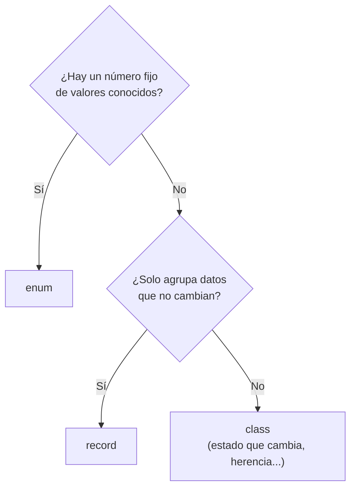

# Tema 18 · Enums y records

[⬅️ Tema anterior](../17-genericos/README.md) · [🏠 Índice](../../INDICE.md) · [Siguiente tema ➡️](../19-lambdas-y-streams/README.md)

Hay dos situaciones que aparecen en casi todos los programas: un dato que solo puede tomar **unos pocos valores fijos** (los días de la semana, las tallas de una camiseta, el estado de un pedido) y una clase que solo sirve para **agrupar datos** (un punto con `x` e `y`, una línea de un pedido). Java tiene una herramienta especializada para cada una: los **enums** y los **records**. Con ellas escribes menos código y cometes menos errores.

## 🎯 Objetivos

- Representar conjuntos cerrados de valores con **`enum`**.
- Usar los métodos de los enums: `values()`, `valueOf()`, `name()`, `ordinal()`.
- Usar enums en `switch` y compararlos con `==`.
- Añadir **atributos, constructores y métodos** a un enum.
- Dar un **comportamiento distinto** a cada constante.
- Conocer **`EnumMap`** y **`EnumSet`**.
- Crear clases de datos inmutables con **`record`**.
- Validar en el **constructor compacto** y añadir métodos a un record.
- Combinar **interfaces `sealed`**, records y **patrones de registro** en un `switch`.
- Decidir cuándo usar clase, enum o record.

## 📚 Contenido

1. [El problema de los valores fijos](#1-el-problema-de-los-valores-fijos)
2. [Enums básicos](#2-enums-básicos)
3. [Métodos de los enums](#3-métodos-de-los-enums)
4. [Enums con atributos y métodos](#4-enums-con-atributos-y-métodos)
5. [Comportamiento distinto por constante](#5-comportamiento-distinto-por-constante)
6. [EnumMap y EnumSet](#6-enummap-y-enumset)
7. [Records](#7-records)
8. [Personalizar un record](#8-personalizar-un-record)
9. [Records, sealed y patrones](#9-records-sealed-y-patrones)
10. [¿Clase, enum o record?](#10-clase-enum-o-record)
11. [Errores típicos](#11-errores-típicos)
12. [Resumen](#12-resumen)

---

## 1. El problema de los valores fijos

Imagina que guardas el estado de un pedido con un `String` o con un `int`:

```java
String estado = "enviado";
estado = "enviadoo";      // Error de escritura: el compilador no se entera

int talla = 2;            // ¿2 es M? ¿Es L? Hay que mirar la documentación
talla = 57;               // Nadie impide un valor sin sentido
```

| Problema | Con `String` / `int` | Con `enum` |
|---|---|---|
| Valores no válidos | Se aceptan (`"enviadoo"`, `57`) | Imposible: solo existen las constantes declaradas |
| Errores de escritura | Se descubren al ejecutar (o nunca) | Error de **compilación** |
| Saber qué valores hay | Mirar la documentación | El editor los autocompleta |
| Añadir datos a cada valor | Arrays paralelos | Atributos en el propio enum |

## 2. Enums básicos

Un **enum** (*enumeración*) es un tipo con un número **fijo** de valores posibles, llamados **constantes**:

```java
enum Dia {
    LUNES, MARTES, MIERCOLES, JUEVES, VIERNES, SABADO, DOMINGO
}

Dia hoy = Dia.VIERNES;
```

- Por convención, las constantes van en **MAYÚSCULAS** (como las constantes `static final`).
- Cada constante es un **objeto** único del tipo `Dia`. No se puede hacer `new Dia()`.
- Como solo existe un objeto por constante, se comparan con **`==`** (es seguro y es lo habitual).

**En un `switch`**, se escribe solo el nombre de la constante:

```java
String tipo = switch (hoy) {
    case SABADO, DOMINGO -> "fin de semana";
    default -> "laborable";
};
```

Si el `switch` cubre **todas** las constantes, no necesita `default`: el compilador comprueba que no falta ninguna (es **exhaustivo**, como con `sealed` en el tema 14).

En este repositorio, los enums se escriben dentro de la clase principal, igual que las clases auxiliares. Un enum anidado ya es `static` automáticamente.

## 3. Métodos de los enums

Todos los enums heredan automáticamente estos métodos:

| Método | Qué hace | Ejemplo | Resultado |
|---|---|---|---|
| `values()` | Array con todas las constantes, en orden | `Dia.values()` | `[LUNES, MARTES, ...]` |
| `valueOf(texto)` | La constante con ese nombre exacto | `Dia.valueOf("MARTES")` | `Dia.MARTES` |
| `name()` | El nombre como texto | `Dia.MARTES.name()` | `"MARTES"` |
| `toString()` | Por defecto, igual que `name()` | `"" + Dia.MARTES` | `"MARTES"` |
| `ordinal()` | La posición (desde 0) | `Dia.MARTES.ordinal()` | `1` |
| `compareTo(otro)` | Compara por posición | `Dia.LUNES.compareTo(Dia.MARTES)` | negativo |

```java
for (Dia d : Dia.values()) {
    System.out.println(d.ordinal() + ": " + d);
}
```

⚠️ `valueOf` lanza `IllegalArgumentException` si el texto no coincide **exactamente** (mayúsculas incluidas): `Dia.valueOf("martes")` falla. Para leer lo que escribe un usuario, conviértelo antes con `toUpperCase()` y captura la excepción (tema 15).

> No uses `ordinal()` para guardar datos ni para cálculos importantes: si un día reordenas las constantes, todos los números cambian. Para eso están los atributos.

## 4. Enums con atributos y métodos

Un enum es una clase especial: puede tener **atributos**, un **constructor** y **métodos**. Los valores de cada constante se escriben entre paréntesis:

```java
enum Talla {
    S("Pequeña", 0.0),
    M("Mediana", 0.0),
    L("Grande", 1.5),
    XL("Muy grande", 3.0);          // ← punto y coma: aquí acaban las constantes

    private final String descripcion;
    private final double recargo;

    Talla(String descripcion, double recargo) {     // El constructor es siempre private
        this.descripcion = descripcion;
        this.recargo = recargo;
    }

    public String getDescripcion() { return descripcion; }
    public double getRecargo() { return recargo; }

    public boolean esGrande() {
        return this == L || this == XL;
    }
}

double precio = 12.0 + Talla.XL.getRecargo();   // 15.0
```

- Las constantes van **primero**, y después de la última se pone **`;`**.
- El constructor es `private` aunque no lo escribas: solo lo usan las constantes.
- Los atributos deberían ser `final`: un enum representa valores fijos.
- Puedes sobrescribir `toString()` para mostrar un texto más amigable.

Un patrón habitual es un método `static` que busca una constante por uno de sus atributos (por ejemplo, por un código), recorriendo `values()`.

## 5. Comportamiento distinto por constante

Cuando cada constante tiene que **hacer** algo distinto, hay dos opciones:

**Opción A: un `switch` sobre `this`** dentro de un método del enum:

```java
enum Semaforo {
    VERDE, AMBAR, ROJO;

    Semaforo siguiente() {
        return switch (this) {
            case VERDE -> AMBAR;
            case AMBAR -> ROJO;
            case ROJO -> VERDE;
        };
    }
}
```

**Opción B: un método abstracto** que cada constante implementa con su propio cuerpo `{ }`:

```java
enum Operacion {
    SUMA("+") {
        double aplicar(double a, double b) { return a + b; }
    },
    RESTA("-") {
        double aplicar(double a, double b) { return a - b; }
    };

    private final String simbolo;

    Operacion(String simbolo) { this.simbolo = simbolo; }

    abstract double aplicar(double a, double b);
}

Operacion.SUMA.aplicar(3, 4);   // 7.0
```

Con la opción B, si añades una constante nueva y olvidas su método, **no compila**. Con la opción A, el `switch` exhaustivo sin `default` consigue lo mismo.

## 6. EnumMap y EnumSet

Para usar enums en colecciones, el JDK tiene versiones especializadas, más rápidas y que **mantienen el orden de declaración**:

```java
Map<Dia, Integer> horas = new EnumMap<>(Dia.class);   // Dia.class: "la clase Dia"
horas.put(Dia.LUNES, 6);
horas.put(Dia.MARTES, 5);

Set<Dia> finde = EnumSet.of(Dia.SABADO, Dia.DOMINGO);
Set<Dia> laborables = EnumSet.range(Dia.LUNES, Dia.VIERNES);
Set<Dia> todos = EnumSet.allOf(Dia.class);
Set<Dia> ninguno = EnumSet.noneOf(Dia.class);
```

## 7. Records

Muchas clases solo sirven para **transportar datos**. Escribir una clase así "como se debe" (temas 12 y 13) es largo:

```java
// Una clase de datos inmutable "a mano": unas 30 líneas
final class Punto {
    private final double x;
    private final double y;
    Punto(double x, double y) { this.x = x; this.y = y; }
    double getX() { return x; }
    double getY() { return y; }
    @Override public boolean equals(Object o) { ... }
    @Override public int hashCode() { ... }
    @Override public String toString() { ... }
}
```

Un **record** (desde Java 16) hace **exactamente lo mismo** en una línea:

```java
record Punto(double x, double y) { }
```

Con esa línea, Java genera automáticamente:

| Qué | Cómo se usa |
|---|---|
| Atributos `private final` | `x`, `y` |
| Constructor con todos los atributos (**canónico**) | `new Punto(3, 4)` |
| Un método **accesor** por atributo (sin `get`) | `p.x()`, `p.y()` |
| `equals` y `hashCode` según **todos** los atributos | `new Punto(1, 2).equals(new Punto(1, 2))` → `true` |
| `toString` | `Punto[x=3.0, y=4.0]` |

```java
Punto p = new Punto(3, 4);
System.out.println(p.x());       // 3.0  (no getX())
System.out.println(p);           // Punto[x=3.0, y=4.0]
```

Características de los records:

- Son **inmutables**: no hay setters y los atributos son `final`. Para "cambiar" un dato se crea un record nuevo.
- Son `final`: no se puede heredar de ellos. Tampoco pueden heredar de otra clase (ya heredan de `Record`), pero **sí pueden implementar interfaces**.
- Como tienen `equals` y `hashCode`, funcionan perfectamente en un `HashSet` o como clave de un `HashMap` (tema 16).

## 8. Personalizar un record

**Validar con el constructor compacto.** Se escribe sin paréntesis ni parámetros; los atributos se asignan solos al final:

```java
record Fraccion(int numerador, int denominador) {
    Fraccion {                                     // Constructor compacto
        if (denominador == 0) {
            throw new IllegalArgumentException("El denominador no puede ser 0");
        }
        if (denominador < 0) {                     // Se pueden "corregir" los parámetros
            numerador = -numerador;
            denominador = -denominador;
        }
    }                                              // Aquí Java hace this.numerador = numerador...
}
```

**Añadir métodos**, también `static`:

```java
record Fraccion(int numerador, int denominador) {
    double valor() {
        return (double) numerador / denominador;
    }

    Fraccion multiplicar(Fraccion otra) {          // Devuelve un record NUEVO
        return new Fraccion(numerador * otra.numerador, denominador * otra.denominador);
    }

    static Fraccion entero(int n) {                // Método de fábrica
        return new Fraccion(n, 1);
    }
}
```

**Métodos "con" (*withers*)** para obtener una copia con un dato cambiado:

```java
record Alumno(String nombre, double nota) {
    Alumno conNota(double nuevaNota) {
        return new Alumno(nombre, nuevaNota);
    }
}
```

Un record **no puede** tener atributos de instancia además de los de su cabecera (sí atributos `static`).

> ⚠️ Inmutable no significa "totalmente congelado": si un componente es una lista modificable, el record guarda la **referencia** y alguien podría cambiar la lista desde fuera. En el constructor compacto, haz una copia defensiva con `List.copyOf(lista)` (tema 12).

## 9. Records, sealed y patrones

Los records encajan muy bien con las interfaces `sealed` del tema 14: la interfaz dice **qué tipos** existen y cada record dice **qué datos** tiene.

```java
sealed interface Figura permits Circulo, Rectangulo { }
record Circulo(double radio) implements Figura { }
record Rectangulo(double ancho, double alto) implements Figura { }
```

Desde Java 21, un `switch` puede **desmontar** un record en sus componentes con un **patrón de registro** (*record pattern*):

```java
static double area(Figura f) {
    return switch (f) {
        case Circulo(double radio) -> Math.PI * radio * radio;
        case Rectangulo(double ancho, double alto) -> ancho * alto;
    };                              // Sin default: Figura es sealed y están todos los casos
}
```

`case Circulo(double radio)` significa "si `f` es un `Circulo`, saca su `radio` en una variable". Se pueden añadir condiciones con `when` y anidar patrones:

```java
case Rectangulo(double ancho, double alto) when ancho == alto -> "un cuadrado";
```

También funcionan con `instanceof`: `if (f instanceof Circulo(double r)) { ... }`.

## 10. ¿Clase, enum o record?



| | `class` | `enum` | `record` |
|---|---|---|---|
| ¿Cuántos objetos? | Los que crees | Solo las constantes | Los que crees |
| ¿Mutable? | Puede serlo | No (debería) | No |
| `equals`/`hashCode`/`toString` | Los escribes tú | Automáticos (por identidad) | Automáticos (por datos) |
| ¿Herencia? | Sí | No | No (pero implementa interfaces) |
| Ejemplo | `CuentaBancaria` (su saldo cambia) | `EstadoPedido` | `Punto`, `LineaPedido` |

## 11. Errores típicos

| Error | Ejemplo | Qué pasa |
|---|---|---|
| Olvidar el `;` tras las constantes | `S("Pequeña"), M("Mediana") private final ...` | Error de compilación |
| Hacer `new` de un enum | `new Dia()` | Error de compilación |
| `valueOf` con un texto que no coincide | `Dia.valueOf("lunes")` | `IllegalArgumentException` |
| Escribir el tipo en un `case` | `case Dia.LUNES ->` | Funciona desde Java 21, pero lo habitual es `case LUNES ->` |
| Usar `getX()` en un record | `p.getX()` | `cannot find symbol`: el accesor es `p.x()` |
| Intentar modificar un record | `p.x = 5;` | Error: los atributos son `final` |
| Asignar atributos en el constructor compacto | `this.x = x;` dentro de `Punto { }` | Error: se asignan solos al final |
| Añadir un atributo de instancia a un record | `record P(int x) { int y; }` | Error de compilación |
| Usar `ordinal()` como dato | Guardar precios según la posición | Se rompe si se reordenan las constantes |

## 12. Resumen

- Un **`enum`** define un tipo con valores **fijos**. Se comparan con `==` y se usan directamente en `switch`.
- Métodos automáticos: `values()`, `valueOf()`, `name()`, `ordinal()`.
- Los enums pueden tener **atributos `final`**, **constructor** (privado) y **métodos**. Las constantes van primero, terminadas en `;`.
- Para comportamiento distinto por constante: `switch (this)` o un **método abstracto** implementado en cada constante.
- **`EnumMap`** y **`EnumSet`** son las colecciones especializadas para enums.
- Un **`record`** es una clase de datos **inmutable**: genera constructor, accesores (`x()`), `equals`, `hashCode` y `toString`.
- El **constructor compacto** valida (o normaliza) los datos. Los records pueden tener métodos e implementar interfaces.
- **`sealed` + records + patrones de registro** permiten `switch` exhaustivos que desmontan los datos: `case Circulo(double r) -> ...`.

---

## 💻 Ejemplos de código

| Archivo | Qué muestra |
|---|---|
| [T18_01_EnumBasico.java](ejemplos/T18_01_EnumBasico.java) | Declarar y usar un enum, `switch`, `values`, `valueOf`, `ordinal` |
| [T18_02_EnumConAtributos.java](ejemplos/T18_02_EnumConAtributos.java) | Enums con atributos, constructor, métodos y búsqueda por código |
| [T18_03_EnumConComportamiento.java](ejemplos/T18_03_EnumConComportamiento.java) | Métodos abstractos por constante, `switch (this)`, `EnumMap` y `EnumSet` |
| [T18_04_RecordsBasico.java](ejemplos/T18_04_RecordsBasico.java) | Qué genera un record y cómo se compara con una clase |
| [T18_05_RecordsAvanzado.java](ejemplos/T18_05_RecordsAvanzado.java) | Constructor compacto, métodos, *withers*, `Comparable` y records en colecciones |
| [T18_06_SealedYPatrones.java](ejemplos/T18_06_SealedYPatrones.java) | `sealed` + records y patrones de registro en `switch` e `instanceof` |

## ✏️ Ejercicios

Practica lo aprendido en los [ejercicios del tema 18](../../ejercicios/18-enums-y-records/README.md).

---

[⬅️ Tema anterior](../17-genericos/README.md) · [🏠 Índice](../../INDICE.md) · [Siguiente tema ➡️](../19-lambdas-y-streams/README.md)
