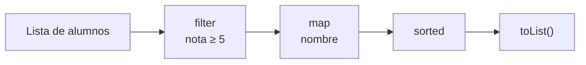

# Tema 19 · Lambdas y streams

[⬅️ Tema anterior](../18-enums-y-records/README.md) · [🏠 Índice](../../INDICE.md) · [Siguiente tema ➡️](../20-ficheros/README.md)

Hasta ahora, para decirle a un método **qué hacer** (cómo comparar, qué filtrar) tenías que crear una clase que implementara una interfaz, o una clase anónima de varias líneas (temas 14 y 17). Desde Java 8, una **lambda** expresa esa misma idea en una línea: `alumno -> alumno.nota() >= 5`. Y con los **streams**, procesar colecciones (filtrar, transformar, ordenar, agrupar, sumar) se escribe como una cadena de pasos que se lee casi como una frase.

## 🎯 Objetivos

- Entender qué es una **interfaz funcional** y qué es una **lambda**.
- Escribir lambdas con la sintaxis correcta y saber qué variables pueden usar.
- Usar las interfaces funcionales del JDK: `Predicate`, `Function`, `Consumer`, `Supplier`...
- Simplificar lambdas con **referencias a métodos** (`::`).
- Usar lambdas con colecciones: `forEach`, `removeIf`, `sort`, `merge`...
- Construir ordenaciones con **`Comparator`**.
- Procesar datos con **streams**: operaciones intermedias y terminales.
- Tratar resultados que pueden no existir con **`Optional`**.
- Agrupar y resumir datos con **`Collectors`**.

## 📚 Contenido

1. [De la clase anónima a la lambda](#1-de-la-clase-anónima-a-la-lambda)
2. [Interfaces funcionales](#2-interfaces-funcionales)
3. [Sintaxis de las lambdas](#3-sintaxis-de-las-lambdas)
4. [Las interfaces funcionales del JDK](#4-las-interfaces-funcionales-del-jdk)
5. [Referencias a métodos](#5-referencias-a-métodos)
6. [Lambdas y colecciones](#6-lambdas-y-colecciones)
7. [Comparator](#7-comparator)
8. [¿Qué es un stream?](#8-qué-es-un-stream)
9. [Operaciones intermedias](#9-operaciones-intermedias)
10. [Operaciones terminales](#10-operaciones-terminales)
11. [Optional](#11-optional)
12. [Collectors: agrupar y resumir](#12-collectors-agrupar-y-resumir)
13. [Buenas prácticas](#13-buenas-prácticas)
14. [Errores típicos](#14-errores-típicos)
15. [Resumen](#15-resumen)

---

## 1. De la clase anónima a la lambda

En el tema 17 escribiste un filtro con una clase anónima:

```java
Filtro<Producto> sinStock = new Filtro<>() {
    @Override
    public boolean cumple(Producto p) {
        return p.getStock() == 0;
    }
};
```

De esas seis líneas, lo único que importa es `p.getStock() == 0`. Todo lo demás lo podría deducir el compilador: el tipo (`Filtro<Producto>`), el único método que hay que implementar (`cumple`) y lo que recibe (un `Producto`). Una **lambda** escribe solo lo importante:

```java
Filtro<Producto> sinStock = p -> p.getStock() == 0;
```

Se lee: "dado un `p`, devuelve si `p.getStock() == 0`". Es una **función** que se guarda en una variable y se pasa a otros métodos, igual que un dato.

## 2. Interfaces funcionales

Una lambda solo puede usarse donde se espera una **interfaz funcional**: una interfaz con **un único método abstracto** (puede tener métodos `default` y `static`). Así el compilador sabe qué método está implementando la lambda.

```java
@FunctionalInterface                    // Opcional: el compilador comprueba que solo hay un método abstracto
interface Operacion {
    double aplicar(double a, double b);
}

Operacion suma = (a, b) -> a + b;
Operacion potencia = (a, b) -> Math.pow(a, b);
System.out.println(suma.aplicar(3, 4));        // 7.0
```

Ya conoces algunas interfaces funcionales: `Comparable<T>` (`compareTo`) y los `Filtro<T>` y `Transformador<T, R>` del tema 17.

## 3. Sintaxis de las lambdas

```
(parámetros) -> cuerpo
```

| Forma | Ejemplo | Cuándo |
|---|---|---|
| Un parámetro, sin paréntesis | `x -> x * 2` | Un solo parámetro |
| Varios parámetros | `(a, b) -> a + b` | Dos o más |
| Sin parámetros | `() -> "hola"` | Ninguno |
| Con tipos explícitos | `(String s) -> s.length()` | Casi nunca hace falta |
| Cuerpo con bloque | `x -> { int y = x * 2; return y + 1; }` | Varias instrucciones: llaves y `return` |

- Si el cuerpo es **una expresión**, su valor se devuelve automáticamente (sin `return` ni llaves).
- Si es un **bloque** `{ }`, se usa `return` como en un método normal.

**Variables de fuera de la lambda.** Una lambda puede **leer** las variables locales del método donde está, pero solo si son **efectivamente finales**: que no cambien después de asignarlas.

```java
int minimo = 5;
Predicate<Integer> aprobado = n -> n >= minimo;   // ✅ minimo no cambia
// minimo = 6;                                     // ❌ Si añades esto, la lambda deja de compilar
```

Los **atributos** de los objetos sí se pueden modificar dentro de una lambda, pero hacerlo suele ser mala idea (sección 13).

## 4. Las interfaces funcionales del JDK

Para no tener que crear una interfaz cada vez, el paquete `java.util.function` trae las más habituales:

| Interfaz | Método | Recibe → devuelve | Para qué | Ejemplo |
|---|---|---|---|---|
| `Predicate<T>` | `test` | `T` → `boolean` | Una **condición** | `s -> s.isEmpty()` |
| `Function<T, R>` | `apply` | `T` → `R` | **Transformar** | `s -> s.length()` |
| `Consumer<T>` | `accept` | `T` → nada | **Hacer algo** con un dato | `s -> System.out.println(s)` |
| `Supplier<T>` | `get` | nada → `T` | **Producir** un dato | `() -> new ArrayList<>()` |
| `UnaryOperator<T>` | `apply` | `T` → `T` | Transformar sin cambiar de tipo | `s -> s.toUpperCase()` |
| `BinaryOperator<T>` | `apply` | `T, T` → `T` | Combinar dos en uno | `(a, b) -> a + b` |
| `BiFunction<T, U, R>` | `apply` | `T, U` → `R` | Transformar dos datos | `(nombre, edad) -> nombre + " (" + edad + ")"` |

```java
Predicate<String> esLarga = s -> s.length() > 5;
Function<String, Integer> longitud = s -> s.length();
Consumer<String> mostrar = s -> System.out.println("→ " + s);

esLarga.test("murciélago");       // true
longitud.apply("hola");           // 4
mostrar.accept("hola");           // → hola
```

**Combinarlas.** Muchas traen métodos `default` para construir funciones a partir de otras:

```java
Predicate<String> empiezaPorA = s -> s.startsWith("a");
Predicate<String> larga = s -> s.length() > 5;

Predicate<String> ambas = empiezaPorA.and(larga);
Predicate<String> alguna = empiezaPorA.or(larga);
Predicate<String> corta = larga.negate();

Function<Integer, Integer> doble = x -> x * 2;
Function<Integer, Integer> masUno = x -> x + 1;
Function<Integer, Integer> dobleYMasUno = doble.andThen(masUno);   // 5 → 11
```

> Para números existen versiones sin autoboxing, más eficientes: `IntPredicate`, `IntFunction`, `ToIntFunction`, `IntBinaryOperator`...

## 5. Referencias a métodos

Cuando una lambda solo **llama a un método que ya existe**, se puede escribir aún más corto con `::`:

| Tipo | Lambda | Referencia a método |
|---|---|---|
| Método `static` | `s -> Integer.parseInt(s)` | `Integer::parseInt` |
| Método de un objeto concreto | `s -> System.out.println(s)` | `System.out::println` |
| Método del propio parámetro | `s -> s.toUpperCase()` | `String::toUpperCase` |
| Constructor | `() -> new ArrayList<>()` | `ArrayList::new` |

```java
List<String> nombres = List.of("ana", "luis");
nombres.forEach(System.out::println);
Function<String, Integer> aNumero = Integer::parseInt;
```

Úsalas cuando hagan el código **más claro**. Si dudas, una lambda siempre funciona.

## 6. Lambdas y colecciones

Las colecciones del tema 16 tienen métodos que reciben lambdas:

| Método | Qué hace | Ejemplo |
|---|---|---|
| `lista.forEach(consumer)` | Hace algo con cada elemento | `nombres.forEach(n -> System.out.println(n))` |
| `lista.removeIf(predicate)` | Borra los que cumplen la condición | `notas.removeIf(n -> n < 5)` |
| `lista.replaceAll(operator)` | Sustituye cada elemento | `nombres.replaceAll(String::toUpperCase)` |
| `lista.sort(comparator)` | Ordena con un criterio | `alumnos.sort(Comparator.comparing(Alumno::nombre))` |
| `mapa.forEach((k, v) -> ...)` | Recorre los pares | `stock.forEach((p, n) -> System.out.println(p + ": " + n))` |
| `mapa.merge(k, v, función)` | Si no existe, pone `v`; si existe, los combina | `contador.merge(palabra, 1, Integer::sum)` |
| `mapa.computeIfAbsent(k, función)` | Si no existe, crea el valor; devuelve el valor | `grupos.computeIfAbsent(curso, c -> new ArrayList<>()).add(nombre)` |

Compara con el tema 16:

```java
// Tema 16: el patrón contador
contador.put(palabra, contador.getOrDefault(palabra, 0) + 1);
// Con merge
contador.merge(palabra, 1, Integer::sum);

// Tema 16: borrar con Iterator (5 líneas)
notas.removeIf(n -> n < 5);
```

## 7. Comparator

`Comparable` (tema 14) define **el** orden natural de una clase. Un **`Comparator<T>`** es un criterio de orden **externo**: puedes tener tantos como quieras sin tocar la clase.

```java
record Alumno(String nombre, int edad, double nota) { }

alumnos.sort(Comparator.comparing(Alumno::nombre));                 // Por nombre
alumnos.sort(Comparator.comparingDouble(Alumno::nota).reversed());  // Por nota, de mayor a menor
alumnos.sort(Comparator.comparingInt(Alumno::edad)                  // Por edad y, si empatan...
        .thenComparing(Alumno::nombre));                            // ...por nombre
```

| Método | Qué hace |
|---|---|
| `Comparator.comparing(f)` | Compara por lo que devuelve `f` (que debe ser `Comparable`) |
| `comparingInt(f)`, `comparingDouble(f)` | Igual, para números (más eficiente) |
| `.reversed()` | Invierte el orden |
| `.thenComparing(f)` | Criterio de desempate |
| `Comparator.naturalOrder()` / `reverseOrder()` | Orden natural / inverso |

Compáralo con el `compareTo` de varios criterios del tema 14: es la misma idea, en una línea.

## 8. ¿Qué es un stream?

Un **stream** es una **secuencia de datos que fluye** por una cadena de operaciones, como una cinta transportadora en una fábrica: los elementos entran, pasan por varias estaciones (filtrar, transformar, ordenar) y al final se recoge el resultado.



```java
List<String> aprobados = alumnos.stream()        // 1. Crear el stream
        .filter(a -> a.nota() >= 5)              // 2. Operaciones intermedias
        .map(Alumno::nombre)
        .sorted()
        .toList();                               // 3. Operación terminal
```

Ideas clave:

- Un stream **no guarda** datos ni **modifica** la colección original: produce un resultado nuevo.
- Las operaciones **intermedias** devuelven otro stream, así que se encadenan. Son **perezosas**: no hacen nada hasta que llega una operación **terminal**.
- La operación **terminal** produce el resultado (una lista, un número, un `boolean`...) y **cierra** el stream: no se puede reutilizar.

**Crear streams:**

| Desde | Cómo |
|---|---|
| Una colección | `lista.stream()` |
| Unos valores | `Stream.of("a", "b", "c")` |
| Un array | `Arrays.stream(array)` |
| Un rango de enteros | `IntStream.range(0, 10)` (0 a 9), `IntStream.rangeClosed(1, 10)` (1 a 10) |
| Los caracteres de un texto | `texto.chars()` (un `IntStream` de códigos) |
| Las líneas de un texto | `texto.lines()` |

## 9. Operaciones intermedias

| Operación | Qué hace | Ejemplo |
|---|---|---|
| `filter(predicate)` | Deja pasar solo los que cumplen la condición | `.filter(n -> n % 2 == 0)` |
| `map(function)` | Transforma cada elemento | `.map(String::length)` |
| `mapToInt(f)`, `mapToDouble(f)` | Transforma en números (para sumar, media...) | `.mapToInt(Producto::stock)` |
| `sorted()` / `sorted(comparator)` | Ordena | `.sorted(Comparator.reverseOrder())` |
| `distinct()` | Quita duplicados (con `equals`) | `.distinct()` |
| `limit(n)` | Solo los `n` primeros | `.limit(3)` |
| `skip(n)` | Se salta los `n` primeros | `.skip(1)` |
| `flatMap(f)` | Cada elemento produce un stream y se "aplanan" todos en uno | `.flatMap(frase -> Arrays.stream(frase.split(" ")))` |

## 10. Operaciones terminales

| Operación | Devuelve | Ejemplo |
|---|---|---|
| `toList()` | Una `List` inmutable | `.toList()` |
| `collect(collector)` | Lo que construya el `Collector` (sección 12) | `.collect(Collectors.toSet())` |
| `forEach(consumer)` | Nada: hace algo con cada uno | `.forEach(System.out::println)` |
| `count()` | `long`: cuántos hay | `.count()` |
| `sum()`, `average()`, `max()`, `min()` | En `IntStream`/`DoubleStream` | `.mapToInt(x -> x).sum()` |
| `min(comp)`, `max(comp)` | `Optional<T>` | `.max(Comparator.comparing(Alumno::nota))` |
| `anyMatch`, `allMatch`, `noneMatch` | `boolean`: ¿alguno/todos/ninguno cumple? | `.anyMatch(n -> n < 0)` |
| `findFirst()` | `Optional<T>`: el primero (si hay) | `.filter(...).findFirst()` |
| `reduce(inicial, operador)` | Combina todos en uno | `.reduce(0, Integer::sum)` |

Fíjate en `anyMatch` y `findFirst`: **paran en cuanto encuentran** lo que buscan, sin recorrer el resto. Es la búsqueda con bandera del tema 07, sin escribir el bucle.

```java
int[] numeros = {4, 8, 15, 16, 23, 42};
int suma = Arrays.stream(numeros).sum();                     // 108
double media = Arrays.stream(numeros).average().orElse(0);   // 18.0
boolean hayImpares = Arrays.stream(numeros).anyMatch(n -> n % 2 != 0);   // true
long mayoresQue10 = Arrays.stream(numeros).filter(n -> n > 10).count();  // 4
```

## 11. Optional

Algunas operaciones pueden **no tener resultado**: el máximo de una lista vacía, el primero que cumple una condición que nadie cumple... En lugar de devolver `null` (y arriesgarse a un `NullPointerException`), devuelven un **`Optional<T>`**: una caja que puede estar vacía o contener un valor.

```java
Optional<Alumno> mejor = alumnos.stream().max(Comparator.comparingDouble(Alumno::nota));

if (mejor.isPresent()) {
    System.out.println(mejor.get().nombre());
}
mejor.ifPresent(a -> System.out.println(a.nombre()));          // Lo mismo, más corto
String nombre = mejor.map(Alumno::nombre).orElse("nadie");      // Con valor por defecto
```

| Método | Qué hace |
|---|---|
| `isPresent()` / `isEmpty()` | ¿Tiene valor? / ¿Está vacío? |
| `get()` | El valor (lanza `NoSuchElementException` si está vacío: compruébalo antes) |
| `orElse(valor)` | El valor, o `valor` si está vacío |
| `ifPresent(consumer)` | Hace algo solo si hay valor |
| `map(function)` | Transforma el valor si existe |

Los streams numéricos devuelven `OptionalInt`, `OptionalDouble`... con `getAsInt()`, `getAsDouble()`, `orElse(...)`.

## 12. Collectors: agrupar y resumir

`collect` recibe un **`Collector`** que dice cómo construir el resultado. La clase `Collectors` tiene los más útiles:

| Collector | Resultado | Ejemplo |
|---|---|---|
| `toList()`, `toSet()` | Lista / conjunto | `Collectors.toSet()` |
| `joining(sep)` | Un `String` unido | `Collectors.joining(", ")` |
| `toMap(clave, valor)` | Un `Map` | `Collectors.toMap(Alumno::nombre, Alumno::nota)` |
| `groupingBy(clave)` | `Map<K, List<T>>`: agrupa por algo | `Collectors.groupingBy(Alumno::curso)` |
| `groupingBy(clave, downstream)` | Agrupa y resume cada grupo | `groupingBy(Alumno::curso, Collectors.counting())` |
| `partitioningBy(predicate)` | `Map<Boolean, List<T>>`: dos grupos | `partitioningBy(a -> a.nota() >= 5)` |
| `counting()` | Cuántos | |
| `summingInt(f)`, `averagingDouble(f)` | Suma / media de una propiedad | `averagingDouble(Alumno::nota)` |

```java
// Nota media por curso, con los cursos ordenados (TreeMap)
Map<String, Double> mediaPorCurso = alumnos.stream()
        .collect(Collectors.groupingBy(Alumno::curso, TreeMap::new,
                Collectors.averagingDouble(Alumno::nota)));

// Aprobados y suspensos
Map<Boolean, List<Alumno>> partes = alumnos.stream()
        .collect(Collectors.partitioningBy(a -> a.nota() >= 5));
List<Alumno> suspensos = partes.get(false);
```

`groupingBy` es la versión de una línea del "mapa de listas" que construías a mano en el tema 16.

## 13. Buenas prácticas

| ✅ Haz | ❌ Evita |
|---|---|
| Lambdas cortas y claras (una línea) | Lambdas de 15 líneas: mejor un método con nombre y una referencia `::` |
| Un paso por línea en los streams | Toda la cadena en una línea interminable |
| Streams **sin efectos secundarios**: que calculen y devuelvan | Modificar variables o listas externas desde `map` o `filter` |
| Usar `toList()`, `count()`, `sum()`... para obtener resultados | `forEach` + `lista.add(...)` para construir una lista |
| Un bucle normal cuando es más claro | Forzar un stream para algo que un `for` hace mejor |

```java
// ❌ Efecto secundario: funciona, pero no es la idea de un stream
List<String> resultado = new ArrayList<>();
nombres.stream().filter(n -> n.length() > 3).forEach(n -> resultado.add(n));

// ✅ El stream construye el resultado
List<String> resultado = nombres.stream().filter(n -> n.length() > 3).toList();
```

> **Streams y la regla del repositorio:** con `anyMatch`, `findFirst`, `takeWhile` o `limit`, el recorrido se detiene en cuanto tiene la respuesta, sin necesidad de `break` ni de banderas. Es otra forma de cumplir la misma idea: el final del recorrido lo marca la propia operación.

## 14. Errores típicos

| Error | Ejemplo | Qué pasa |
|---|---|---|
| Modificar una variable local desde una lambda | `int total = 0; lista.forEach(x -> total += x);` | `local variables referenced from a lambda expression must be final or effectively final` |
| Lambda donde no hay interfaz funcional | `Object f = x -> x;` | Error: el compilador no sabe qué método implementa |
| Olvidar la operación terminal | `lista.stream().filter(...).map(...);` | No pasa nada: las intermedias son perezosas |
| Reutilizar un stream | Llamar dos veces a una terminal sobre el mismo stream | `IllegalStateException: stream has already been operated upon or closed` |
| `get()` de un `Optional` vacío | `lista.stream().findFirst().get()` con la lista vacía | `NoSuchElementException` |
| Modificar la lista de `toList()` | `stream.toList().add(x)` | `UnsupportedOperationException`: es inmutable |
| Claves repetidas en `toMap` | Dos alumnos con el mismo nombre | `IllegalStateException: Duplicate key` |
| `return` olvidado en un bloque | `x -> { x * 2; }` | Error de compilación: con llaves hace falta `return` |
| Esperar que `sorted()` ordene la lista original | `lista.stream().sorted();` | La lista no cambia: usa `lista.sort(...)` o recoge el resultado |

## 15. Resumen

- Una **lambda** (`x -> x * 2`) es una función anónima que implementa una **interfaz funcional** (un solo método abstracto).
- Solo puede usar variables locales **efectivamente finales**.
- Interfaces del JDK: **`Predicate`** (condición), **`Function`** (transformar), **`Consumer`** (hacer algo), **`Supplier`** (producir), **`BinaryOperator`** (combinar)...
- Las **referencias a métodos** (`String::toUpperCase`, `System.out::println`) acortan las lambdas que solo llaman a un método.
- Colecciones: `forEach`, `removeIf`, `replaceAll`, `sort`, `merge`, `computeIfAbsent`.
- **`Comparator.comparing(...)`** con `reversed()` y `thenComparing(...)` construye criterios de orden.
- Un **stream** = origen + operaciones **intermedias** (`filter`, `map`, `sorted`, `distinct`, `limit`) + una operación **terminal** (`toList`, `count`, `sum`, `anyMatch`, `collect`...). No modifica el origen y no se reutiliza.
- **`Optional`** representa un resultado que puede no existir: `orElse`, `ifPresent`, `map`.
- **`Collectors`**: `groupingBy`, `partitioningBy`, `counting`, `averagingDouble`, `joining`, `toMap`.

---

## 💻 Ejemplos de código

| Archivo | Qué muestra |
|---|---|
| [T19_01_DeClaseAnonimaALambda.java](ejemplos/T19_01_DeClaseAnonimaALambda.java) | La misma idea con una clase, una clase anónima y una lambda; sintaxis y captura de variables |
| [T19_02_InterfacesFuncionales.java](ejemplos/T19_02_InterfacesFuncionales.java) | `Predicate`, `Function`, `Consumer`, `Supplier`, `BinaryOperator` y cómo combinarlas |
| [T19_03_ReferenciasYColecciones.java](ejemplos/T19_03_ReferenciasYColecciones.java) | Referencias a métodos, lambdas con listas y mapas, y `Comparator` |
| [T19_04_StreamsBasico.java](ejemplos/T19_04_StreamsBasico.java) | Crear streams y encadenar `filter`, `map`, `sorted`, `distinct`, `limit` |
| [T19_05_TerminalesYOptional.java](ejemplos/T19_05_TerminalesYOptional.java) | `count`, `sum`, `average`, `anyMatch`, `findFirst`, `reduce` y `Optional` |
| [T19_06_Collectors.java](ejemplos/T19_06_Collectors.java) | `groupingBy`, `partitioningBy`, `counting`, `joining`, `toMap` y `flatMap` |

## ✏️ Ejercicios

Practica lo aprendido en los [ejercicios del tema 19](../../ejercicios/19-lambdas-y-streams/README.md).

---

[⬅️ Tema anterior](../18-enums-y-records/README.md) · [🏠 Índice](../../INDICE.md) · [Siguiente tema ➡️](../20-ficheros/README.md)
